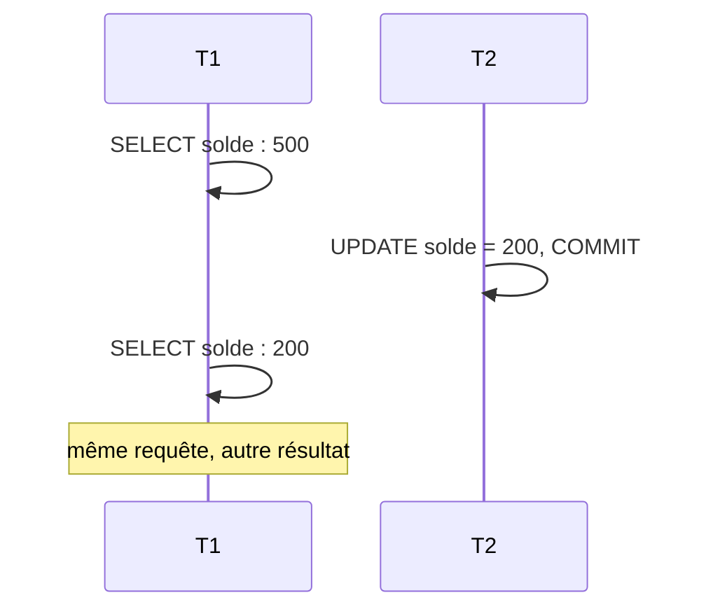
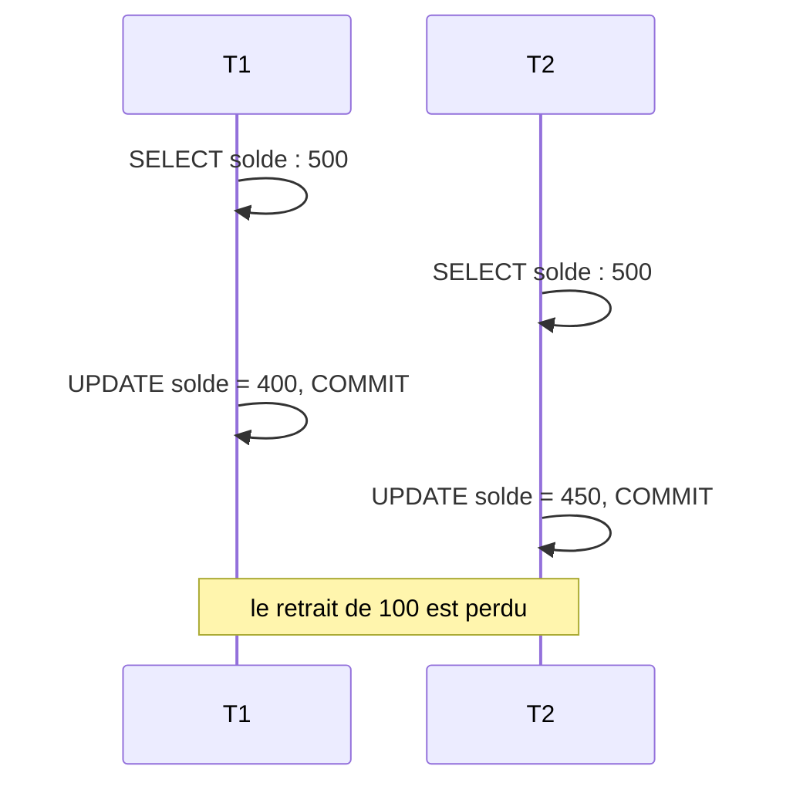
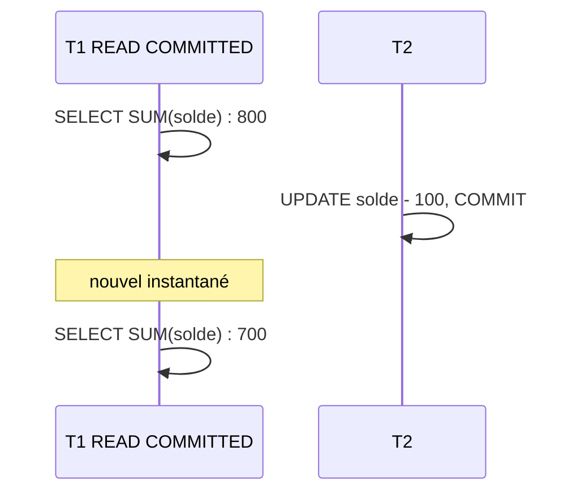
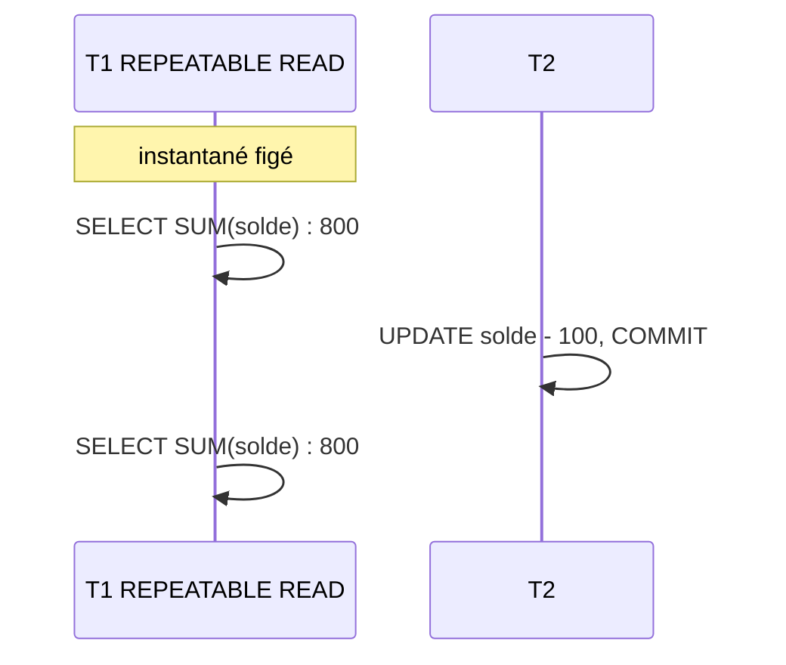
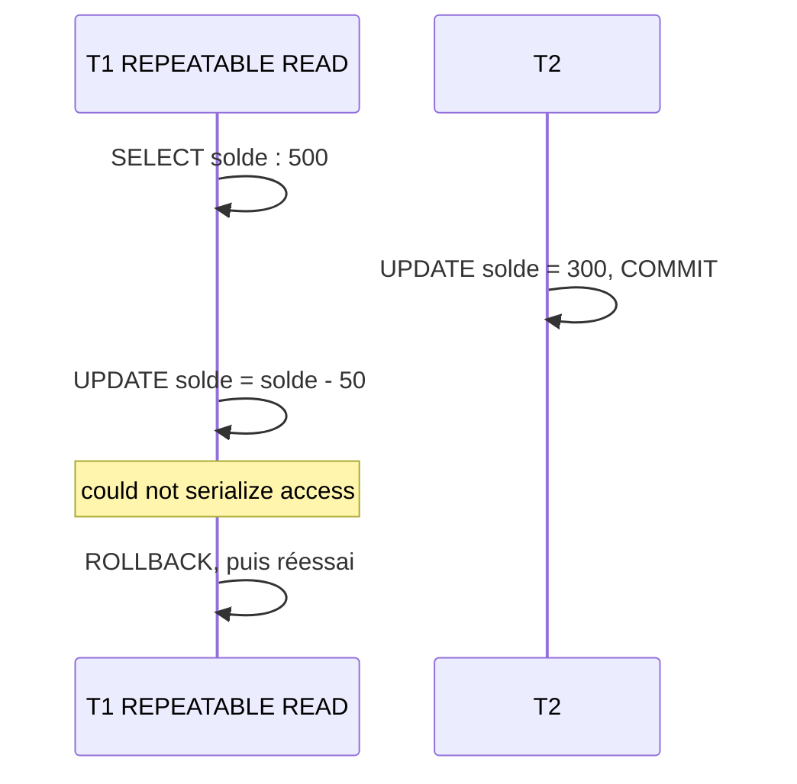
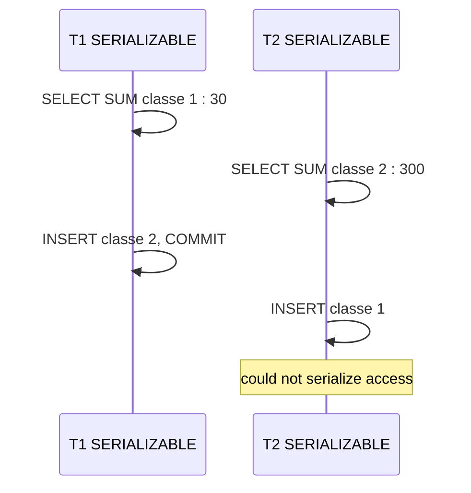
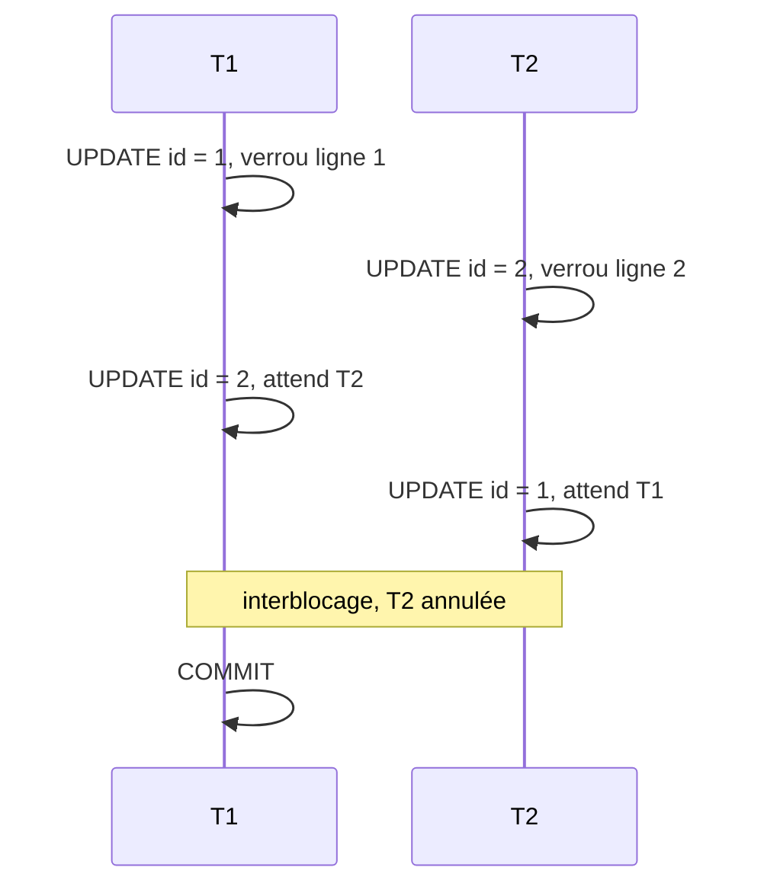

---
layout: default
---

# Cours précédent

- Six dimensions de la qualité des données
- Staging : tout en `TEXT`, sans contrainte
- Nettoyage : `CASE`, `TRIM`, `TO_DATE`, `COALESCE`
- Rejets avec motif, journal d'import, provenance des lignes
- Import rejouable : `ON CONFLICT DO NOTHING`

<Card title="Aujourd'hui" color="#e92528">
<template #icon><pixelarticons-users /></template>
Transactions et garanties ACID, accès simultanés, et ce que coûte la cohérence sous charge.
</Card>

---
layout: two-cols
---

::title::
# Table des exemples

::left::

`compte`

| id | titulaire | solde |
|---|---|---|
| 1 | Alice | 500 |
| 2 | Bob | 300 |

- Tous les exemples partent de cet état
- Même principe pour signalements et interventions

::right::

```sql
CREATE TABLE compte (
  id        INTEGER PRIMARY KEY,
  titulaire VARCHAR(50),
  solde     NUMERIC
);

INSERT INTO compte VALUES
  (1, 'Alice', 500),
  (2, 'Bob',   300);
```

---
layout: section
---

# Transactions

---
layout: two-cols
---

::title::
# Transaction

::left::

- Groupe d'opérations **indivisible**
- Toutes réussissent : `COMMIT`
- Une échoue : `ROLLBACK`, tout est annulé
- Sans `BEGIN` : une transaction par instruction

::right::

<Figure
  src="/images/03/transaction.png"
  caption="<a href='https://www.javatpoint.com/dbms-transaction'>javatpoint.com</a>"
  alt="Cycle de vie d'une transaction"
/>

---
layout: two-cols
references: "PostgreSQL, <em>Transactions</em>"
---

::title::
# Syntaxe : BEGIN, COMMIT, ROLLBACK

::left::

- `BEGIN` : ouvrir la transaction
- `COMMIT` : valider définitivement
- `ROLLBACK` : tout annuler
- Une erreur bloque la suite jusqu'au `ROLLBACK`

::right::

```sql
BEGIN;

-- instructions

COMMIT;
-- ou
ROLLBACK;
```

---
layout: two-cols
---

::title::
# Exemple : virement

::left::

### Besoins

> « Alice vire 100 francs à Bob. L'argent ne doit ni disparaître, ni apparaître. »

### Question

Comment garantir les deux écritures ensemble ?

::right::

<v-click>

```sql
BEGIN;

UPDATE compte SET solde = solde - 100
WHERE id = 1;

UPDATE compte SET solde = solde + 100
WHERE id = 2;

COMMIT;
```

</v-click>

<v-click>

- Deux écritures, une seule unité
- Panne entre les deux : rien n'est appliqué

</v-click>

---
layout: grid
cols: 4
align: stretch
content: center
references:
  - "PostgreSQL, <em>Introduction to WAL</em>"
  - "PostgreSQL, <em>Transaction Isolation</em>"
---

# ACID

<Card title="Atomicité">
<template #icon><pixelarticons-box /></template>
<strong>Tout ou rien.</strong> Une panne annule toute la transaction.
</Card>
<Card title="Cohérence">
<template #icon><pixelarticons-check-double /></template>
D'un état valide à un état valide. Les contraintes tiennent.
</Card>
<Card title="Isolation">
<template #icon><pixelarticons-hidden /></template>
Aucun état intermédiaire visible par les autres transactions.
</Card>
<Card title="Durabilité">
<template #icon><pixelarticons-save /></template>
Validée, elle survit aux pannes, grâce au journal <strong>WAL</strong>.
</Card>

---
layout: section
---

# Concurrence

---
layout: two-cols
---

::title::
# Accès simultanés

::left::

- Des centaines de connexions simultanées
- Une transaction indépendante par connexion
- Lectures et écritures entrelacées
- Deux agents clôturent le même signalement

::right::

| Anomalie | Effet |
|---|---|
| Lecture sale | Lire une valeur non validée |
| Lecture non répétable | Même ligne, autre valeur |
| Lecture fantôme | Nouvelles lignes apparues |
| Mise à jour perdue | Une écriture en écrase une autre |

---
layout: two-cols
references: "PostgreSQL, <em>Transaction Isolation</em>"
---

::title::
# Lecture non répétable

::left::

- T1 lit une ligne, puis la relit
- Entre-temps, T2 l'a modifiée et validée
- Même requête, résultat différent
- Évitée dès `REPEATABLE READ`

::right::



---
layout: two-cols
references: "PostgreSQL, <em>Transaction Isolation</em>"
---

::title::
# Mise à jour perdue

::left::

- T1 et T2 lisent la même valeur
- Chacune écrit sa propre modification
- La dernière écrase la première
- Évitée : `UPDATE` atomique, `FOR UPDATE`, `REPEATABLE READ`

::right::



---
layout: section
---

# Niveaux d'isolation

---
layout: two-cols
references: "PostgreSQL, <em>Read Committed Isolation Level</em>"
---

::title::
# READ COMMITTED

::left::

- Niveau **par défaut** de PostgreSQL
- Ne voit que des données validées
- Nouvel instantané **à chaque instruction**
- Suffit pour les opérations simples
- Pas pour un rapport en plusieurs requêtes

::right::



---
layout: two-cols
references: "PostgreSQL, <em>Repeatable Read Isolation Level</em>"
---

::title::
# REPEATABLE READ

::left::

- Instantané pris à la **première instruction**
- Toutes les lectures voient ce même état
- Empêche aussi la lecture fantôme dans PostgreSQL
- Adapté aux rapports en plusieurs requêtes

::right::



---
layout: two-cols
references: "PostgreSQL, <em>Repeatable Read Isolation Level</em>"
---

::title::
# Conflit d'écriture

::left::

- T1 modifie une ligne changée depuis son instantané
- PostgreSQL annule T1 : **erreur de sérialisation**
- L'application doit **réessayer**
- En `REPEATABLE READ`, une lecture seule n'échoue jamais

::right::



---
layout: two-cols
references: "PostgreSQL, <em>Serializable Isolation Level</em>"
---

::title::
# SERIALIZABLE

::left::

- Résultat identique à une exécution **l'une après l'autre**
- `REPEATABLE READ` et détection des dépendances
- Lectures non bloquées
- Combinaison impossible : une transaction échoue

::right::



---
layout: default
class: compact
references: "PostgreSQL, <em>Transaction Isolation</em>"
---

# Quatre niveaux

| Niveau | Lecture sale | Non répétable | Fantôme | Sérialisation |
|---|---|---|---|---|
| `READ UNCOMMITTED` | Empêchée dans PostgreSQL | Possible | Possible | Possible |
| `READ COMMITTED` | Empêchée | Possible | Possible | Possible |
| `REPEATABLE READ` | Empêchée | Empêchée | Empêchée dans PostgreSQL | Possible |
| `SERIALIZABLE` | Empêchée | Empêchée | Empêchée | Empêchée |

---
layout: default
---

# Choix du niveau

| Situation | Niveau |
|---|---|
| Opérations courantes, API web | `READ COMMITTED` |
| Rapport en plusieurs requêtes | `REPEATABLE READ` |
| Calcul financier critique | `SERIALIZABLE` |
| Import en masse | `READ COMMITTED`, par lots |
| File de tâches | `READ COMMITTED` et `FOR UPDATE SKIP LOCKED` |

Par défaut `READ COMMITTED`, plus strict seulement là où l'anomalie compte.

---
layout: section
---

# MVCC et verrous

---
layout: two-cols
references: "PostgreSQL, <em>Concurrency Control</em>"
---

::title::
# Versions d'une ligne

::left::

- **M**ulti-**V**ersion **C**oncurrency **C**ontrol
- `xmin` : transaction qui a créé la version
- `xmax` : transaction qui l'a remplacée
- Un `UPDATE` crée une nouvelle version
- Lecteurs et écrivain ne se bloquent pas

::right::

`compte` (versions physiques)

| xmin | xmax | id | solde |
|---|---|---|---|
| 9 | 11 | 1 | 500 |
| 11 | | 1 | 400 |

---
layout: two-cols
references: "PostgreSQL, <em>Explicit Locking</em>"
---

::title::
# Verrous implicites

::left::

- Posés automatiquement par PostgreSQL
- Lecture : aucun verrou, grâce à MVCC
- Écriture : verrou sur la ligne
- Changement de structure : verrou sur la table

::right::

| Instruction | Verrou |
|---|---|
| `SELECT` | Aucun |
| `UPDATE`, `DELETE` | Ligne |
| `ALTER TABLE` | Table |

---
layout: two-cols
references: "PostgreSQL, <em>Deadlocks</em>"
---

::title::
# Interblocage

::left::

- T1 attend T2, T2 attend T1
- Détection après `deadlock_timeout` : 1 s
- PostgreSQL annule l'une : `deadlock detected`
- L'autre continue

::right::



---
layout: section
---

# Cohérence sous charge

---
layout: two-cols
---

::title::
# Coût de la cohérence

::left::

- Isolation stricte : plus de transactions annulées
- Transaction annulée : travail perdu, puis réessai
- Verrou posé : les autres attendent
- Contention : écritures concentrées sur les mêmes lignes
- Le coût dépend de la charge réelle

::right::

<Card title="Arbitrage" color="#e92528" footer="cours 05 · systèmes distribués, CAP">
<template #icon><pixelarticons-scale /></template>
Garantie plus forte ou débit plus élevé : le choix se mesure sur sa propre charge, pas sur une intuition.
</Card>

---
layout: two-cols
references: "PostgreSQL, <em>pgbench</em>"
---

::title::
# Mesure de charge

::left::

- `pgbench` : fourni avec PostgreSQL
- N clients rejouent un script en boucle
- Débit : transactions par seconde (`tps`)
- Échecs et réessais par type d'erreur
- Mesure bruitée : répéter, comparer les écarts

::right::

```text
number of clients: 8
number of failed transactions: 17 (5.199%)
number of serialization failures: 16 (4.893%)
number of deadlock failures: 1 (0.306%)
number of transactions retried: 204 (62.385%)
latency average = 204.970 ms
tps = 37.000925
```

---
layout: grid
cols: 2
align: stretch
content: center
---

# Règles des transactions

<Card title="Courtes">
<template #icon><pixelarticons-clock /></template>
Moins de temps verrouillé, moins de conflits. Jamais d'attente de saisie dans une transaction.
</Card>
<Card title="Même ordre">
<template #icon><pixelarticons-sort /></template>
Accéder aux tables et aux lignes toujours dans le même ordre : plus d'interblocage circulaire.
</Card>
<Card title="Niveau adapté">
<template #icon><pixelarticons-sliders /></template>
<code>READ COMMITTED</code> le plus souvent. Plus strict pour les rapports et les calculs critiques.
</Card>
<Card title="Réessai">
<template #icon><pixelarticons-reload /></template>
Erreur <code>40001</code> : la transaction a été annulée. La relancer en entier.
</Card>

---
layout: section
---

# Travaux pratiques

---
layout: two-cols
routeAlias: tp
---

::title::
# Travail pratique · Semaine 3

::left::

### Déroulé

1. Anomalies à plusieurs sessions : 60 min
2. Mesures avec `pgbench` : 75 min
3. Analyse des mesures : 45 min

<Card color="#6b7280" tag="note" title="Non noté">
<template #icon><pixelarticons-book-open /></template>
Les exercices préparent l'examen final.
</Card>

::right::

### Départ

1. Télécharger [03-banque.sql](https://comem-infradon.onrender.com/exercices/03-banque.sql), [03-virement.sql](https://comem-infradon.onrender.com/exercices/03-virement.sql) et [03-virement-ordonne.sql](https://comem-infradon.onrender.com/exercices/03-virement-ordonne.sql)
2. Les copier dans le dossier `data`
3. Créer les comptes dans `psql`, base `yverdon`

```sql
\i /data/03-banque.sql
```

---
layout: two-cols
---

::title::
# Syntaxe : niveau d'isolation

::left::

- Pour une transaction : à l'ouverture
- Pour la session : toutes les suivantes
- `READ ONLY` : lecture seule

::right::

```sql
BEGIN TRANSACTION ISOLATION LEVEL
  REPEATABLE READ;

SET SESSION CHARACTERISTICS AS TRANSACTION
  ISOLATION LEVEL SERIALIZABLE;

BEGIN TRANSACTION ISOLATION LEVEL
  SERIALIZABLE READ ONLY;
```

---
layout: two-cols
references: "PostgreSQL, <em>Explicit Locking</em>"
---

::title::
# Syntaxe : verrous explicites

::left::

- `FOR UPDATE` : verrou exclusif sur les lignes lues
- `FOR SHARE` : bloque les écritures, pas les lectures
- `NOWAIT` : erreur immédiate si déjà verrouillé
- `SKIP LOCKED` : ignorer les lignes verrouillées

::right::

```sql
SELECT * FROM compte WHERE id = 1
FOR UPDATE;

SELECT * FROM compte
FOR SHARE;

SELECT * FROM compte WHERE id = 1
FOR UPDATE NOWAIT;

SELECT * FROM tache
WHERE statut = 'disponible'
LIMIT 1
FOR UPDATE SKIP LOCKED;
```

---
layout: two-cols
references: "PostgreSQL, <em>pg_blocking_pids</em>"
---

::title::
# Blocages en cours

::left::

- `pg_stat_activity` : connexions et requêtes
- `pg_blocking_pids` : qui bloque une connexion
- Diagnostic d'un blocage en production

::right::

```sql
SELECT
  bloquee.pid    AS pid_bloquee,
  bloquee.query  AS requete_bloquee,
  bloquante.pid  AS pid_bloquante,
  bloquante.query AS requete_bloquante
FROM pg_stat_activity AS bloquee
JOIN pg_stat_activity AS bloquante
  ON bloquante.pid = ANY(
       pg_blocking_pids(bloquee.pid))
WHERE cardinality(
        pg_blocking_pids(bloquee.pid)) > 0;
```

---
layout: two-cols-bottom
---

::title::
# Exercice 1 : lecture non répétable

::left::

### T1

```sql
BEGIN;
SELECT solde FROM compte WHERE id = 1;
-- T2 s'exécute ici
SELECT solde FROM compte WHERE id = 1;
COMMIT;
```

::right::

### T2

```sql
UPDATE compte SET solde = 200
WHERE id = 1;
```

::bottom::

<Card title="Question" color="#e92528">
<template #icon><pixelarticons-scale /></template>
Quel solde T1 lit-elle la seconde fois ? Remettre le solde à 1000, puis refaire avec <code>REPEATABLE READ</code>.
</Card>

---
layout: two-cols-bottom
---

::title::
# Exercice 2 : conflit d'écriture

::left::

### T1

```sql
BEGIN TRANSACTION ISOLATION LEVEL
  REPEATABLE READ;
SELECT solde FROM compte WHERE id = 1;
-- T2 s'exécute ici
UPDATE compte SET solde = solde - 50
WHERE id = 1;
COMMIT;
```

::right::

### T2

```sql
UPDATE compte SET solde = 100
WHERE id = 1;
```

::bottom::

<Card title="Question" color="#e92528">
<template #icon><pixelarticons-scale /></template>
Quel message reçoit T1 ? Quel est le solde final ? Que doit faire l'application ?
</Card>

---
layout: two-cols-bottom
---

::title::
# Exercice 3 : interblocage

::left::

### T1

```sql
BEGIN;
UPDATE compte SET solde = solde - 10
WHERE id = 1;            -- étape 1
UPDATE compte SET solde = solde + 10
WHERE id = 2;            -- étape 3
COMMIT;
```

::right::

### T2

```sql
BEGIN;
UPDATE compte SET solde = solde - 10
WHERE id = 2;            -- étape 2
UPDATE compte SET solde = solde + 10
WHERE id = 1;            -- étape 4
COMMIT;
```

::bottom::

<Card title="Question" color="#e92528">
<template #icon><pixelarticons-scale /></template>
Après l'étape 3, lancer <code>Blocages en cours</code> dans une troisième session. Quelle transaction est annulée à l'étape 4 ? Comment l'éviter ?
</Card>

---
layout: two-cols
references: "PostgreSQL, <em>pgbench</em>"
---

::title::
# Syntaxe : pgbench

::left::

- Lancer dans le conteneur, onglet **Exec**
- `-f` : script, `-D` : variable du script
- `-c` : clients simultanés, `-T` : durée en secondes
- `--max-tries` : essais avant l'échec
- `ALTER DATABASE` : niveau des nouvelles connexions

::right::

```sql
ALTER DATABASE yverdon
  SET default_transaction_isolation
  = 'serializable';
-- Fin du TP : RESET, sans valeur
```

```bash
pgbench -U postgres -n \
  -f /data/03-virement.sql -D nb=10000 \
  -c 32 -j 2 -T 30 \
  --max-tries=10 --failures-detailed \
  yverdon
```

---
layout: two-cols
---

::title::
# Exercice 4 : niveau d'isolation

::left::

### Étapes

1. Lancer `03-virement.sql`, `nb=10000`, 32 clients
2. Recréer la table avant chaque mesure
3. Relever `tps`, réessais, échecs par niveau
4. Répéter trois fois chaque mesure
5. Vérifier `SUM(solde)` à la fin

::right::

`mesures`

| niveau | tps | réessais | échecs |
|---|---|---|---|
| read committed | | | |
| repeatable read | | | |
| serializable | | | |

---
layout: two-cols-bottom
---

::title::
# Exercice 5 : contention

::left::

### Étapes

1. Refaire l'exercice 4 avec `nb=10`
2. Comparer 1 client et 8 clients
3. Relancer avec `03-virement-ordonne.sql`
4. Comparer les interblocages

::right::

```bash
pgbench ... -f /data/03-virement.sql \
  -D nb=10 -c 1 ...

pgbench ... -f /data/03-virement.sql \
  -D nb=10 -c 8 ...

pgbench ... -f /data/03-virement-ordonne.sql \
  -D nb=10 -c 8 ...
```

::bottom::

<Card title="Question" color="#e92528">
<template #icon><pixelarticons-scale /></template>
Pourquoi le débit s'effondre-t-il avec 10 comptes ? Que change l'ordre des mises à jour ? Et le niveau d'isolation, une fois l'ordre corrigé ?
</Card>

---
layout: two-cols
---

::title::
# Exercice 6 : question type

::left::

### Situation

> « On a eu une mise à jour perdue. Passons toute l'application en SERIALIZABLE. »

### Question

Que répondre, à partir des mesures ci-contre ?

::right::

`mesures`

| niveau | tps | réessais | échecs |
|---|---|---|---|
| read committed | 2 238 | 0 | 0 |
| repeatable read | 3 140 | 20 057 | 1 399 |
| serializable | 3 136 | 20 611 | 1 581 |

`03-virement-ordonne.sql`, 10 comptes, 8 clients, 10 s. Échec : abandon après 10 essais.

---
layout: default
---

# Ressources

- [PostgreSQL · Transactions](https://www.postgresql.org/docs/current/tutorial-transactions.html)
- [PostgreSQL · Transaction Isolation](https://www.postgresql.org/docs/current/transaction-iso.html)
- [PostgreSQL · MVCC](https://www.postgresql.org/docs/current/mvcc.html)
- [PostgreSQL · Explicit Locking](https://www.postgresql.org/docs/current/explicit-locking.html)
- [PostgreSQL · pgbench](https://www.postgresql.org/docs/current/pgbench.html)

<Card title="Prochain cours" color="#e92528" footer="cours 04 · Sécurité, rôles et sauvegarde">
<template #icon><pixelarticons-arrow-right /></template>
Rôles et privilèges, suppression des données, sauvegarde et restauration.
</Card>
