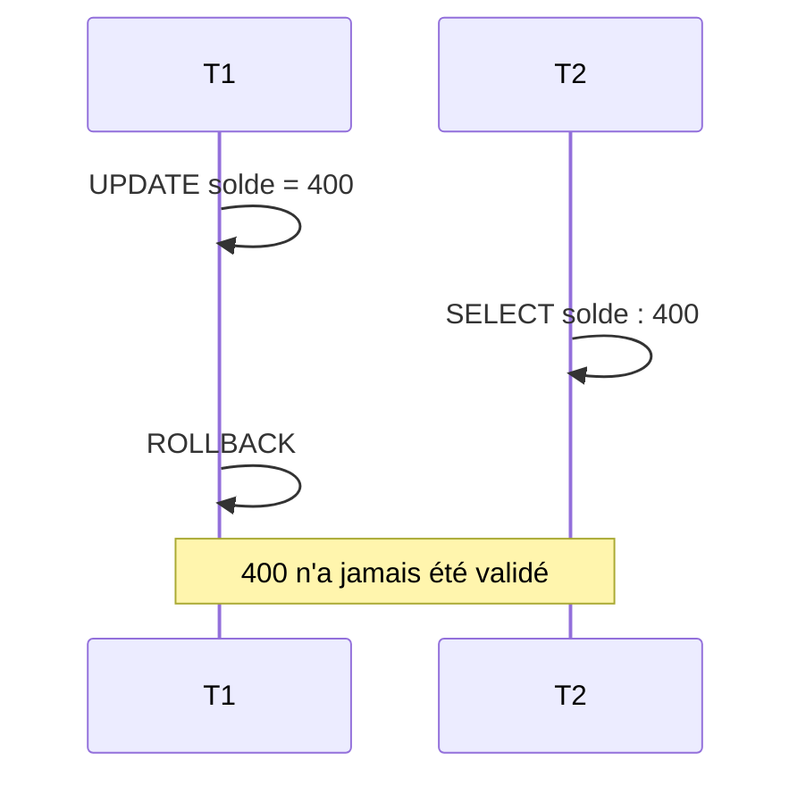
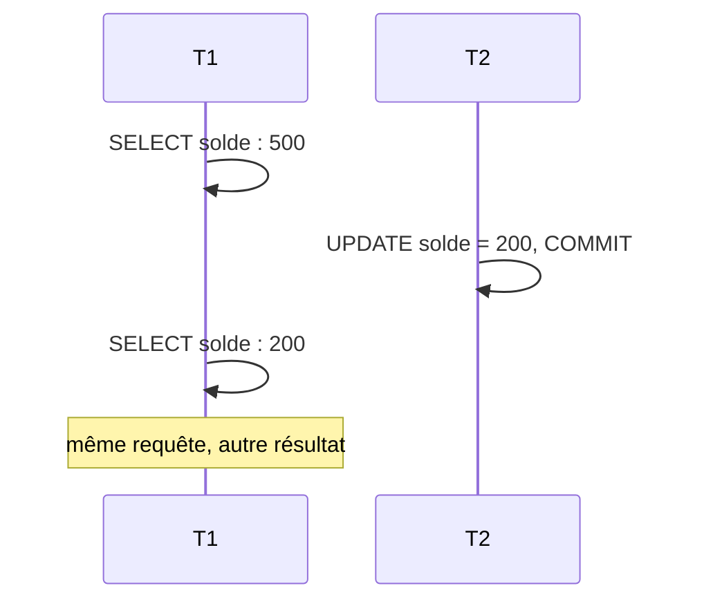
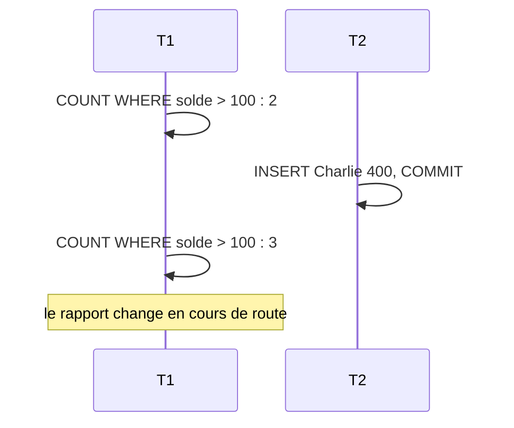
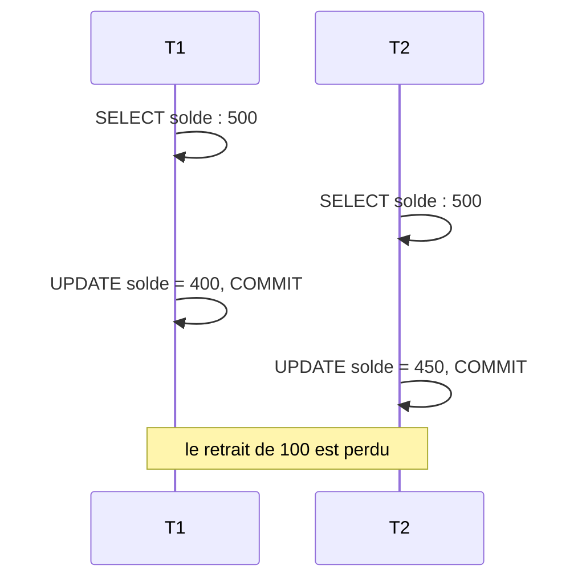
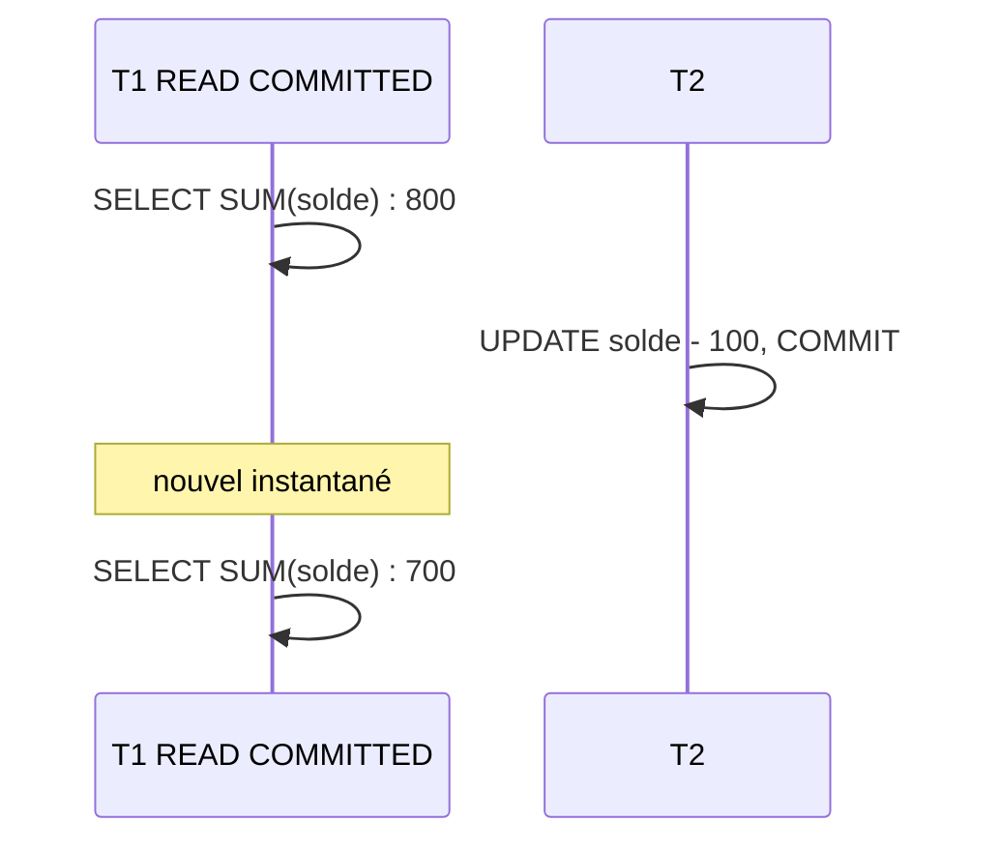
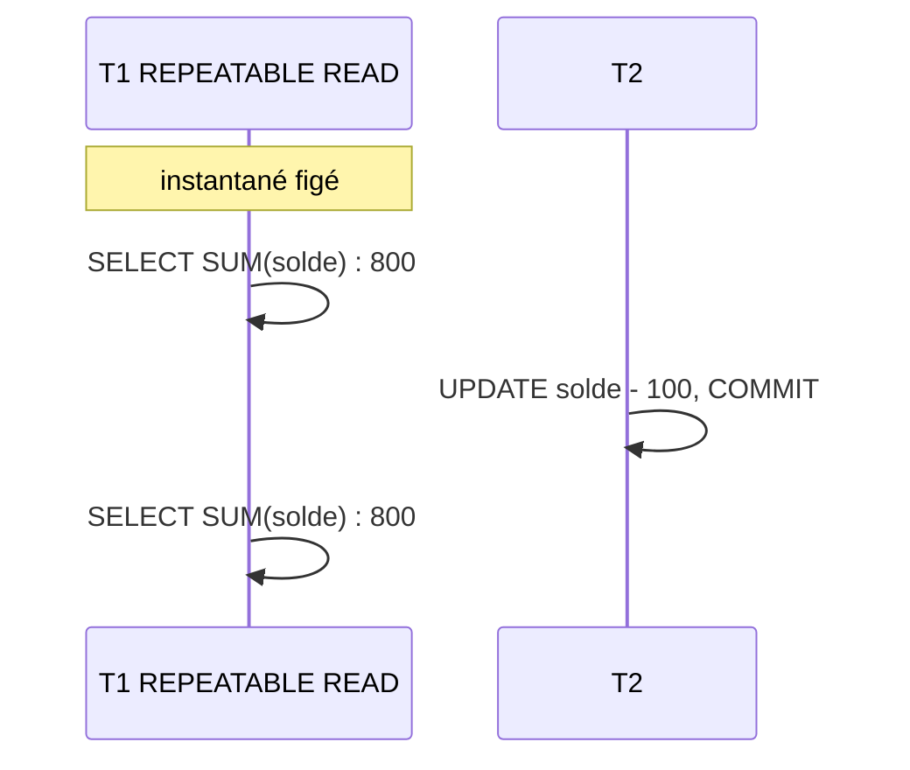
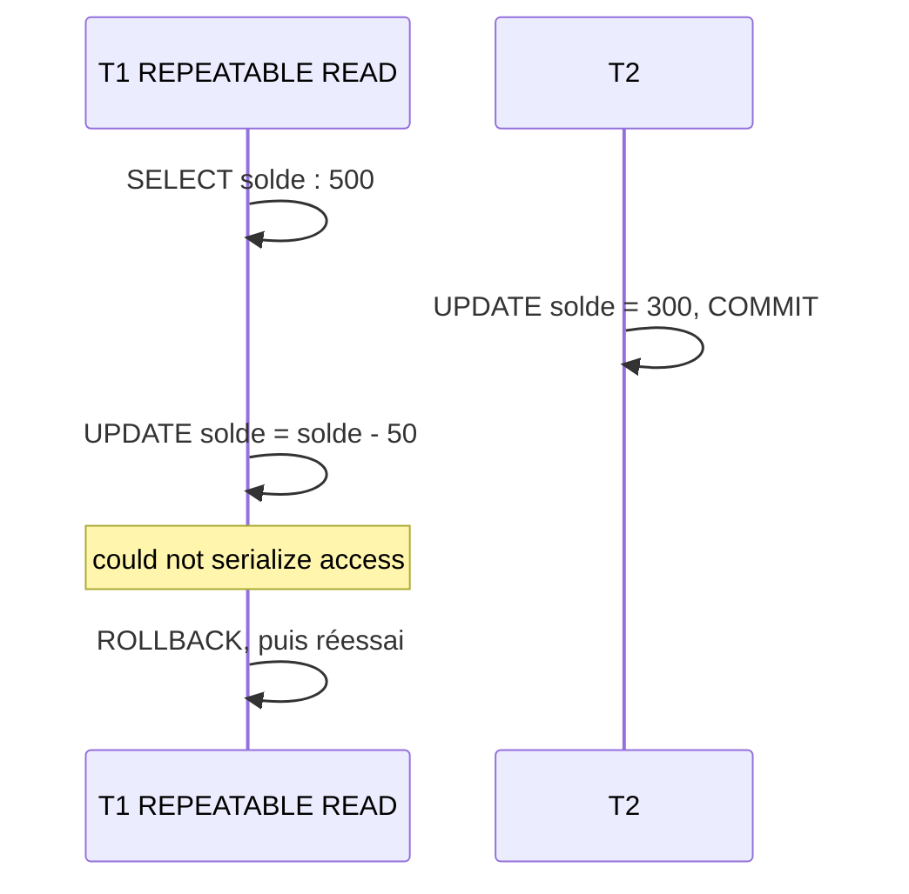
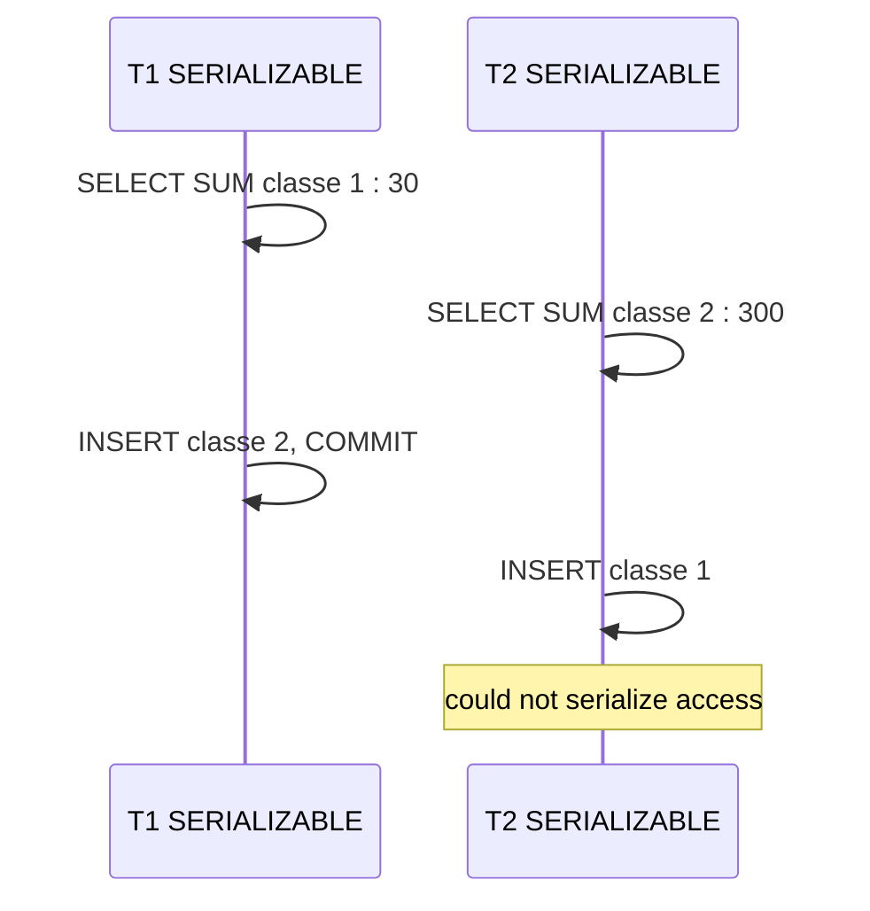
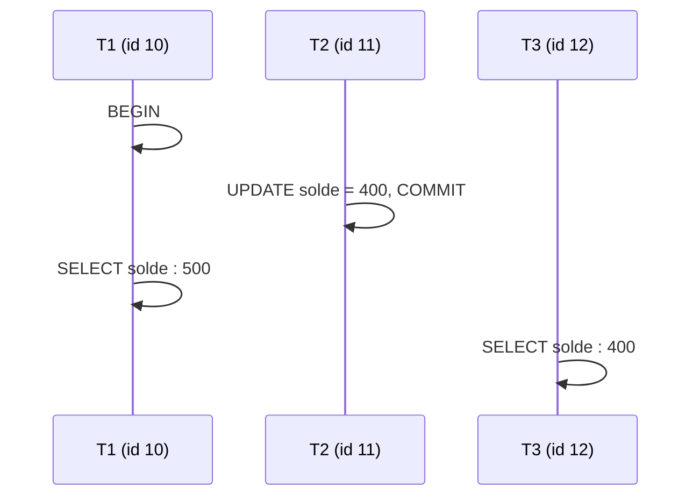
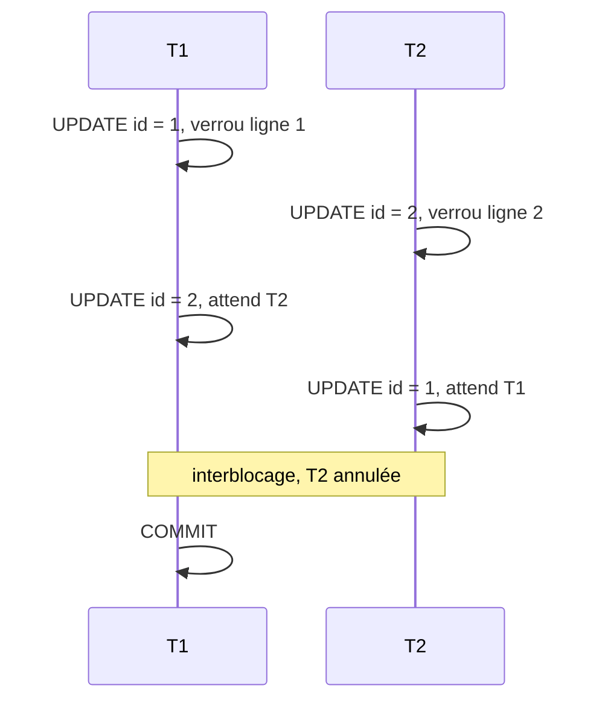

---
layout: default
---

# Cours précédent

- Six dimensions de la qualité des données
- Staging : tout en `TEXT`, sans contrainte
- Nettoyage : `CASE`, `TRIM`, `TO_DATE`, `COALESCE`
- Dédoublonnage avec `ROW_NUMBER`
- Import rejouable : `ON CONFLICT DO NOTHING`

<Card title="Aujourd'hui" color="#e92528">
<template #icon><pixelarticons-users /></template>
Transactions et garanties ACID, puis ce qui se passe quand plusieurs personnes écrivent en même temps.
</Card>

---
layout: two-cols
---

::title::
# Table des exemples

::left::

`compte`

| id | titulaire | solde |
|---|---|---|
| 1 | Alice | 500 |
| 2 | Bob | 300 |

- Tous les exemples partent de cet état
- Même principe pour signalements et interventions

::right::

```sql
CREATE TABLE compte (
  id        INTEGER PRIMARY KEY,
  titulaire VARCHAR(50),
  solde     NUMERIC
);

INSERT INTO compte VALUES
  (1, 'Alice', 500),
  (2, 'Bob',   300);
```

---
layout: section
---

# Transactions

---
layout: two-cols
---

::title::
# Transaction

::left::

- Groupe d'opérations **indivisible**
- Toutes réussissent : `COMMIT`
- Une échoue : `ROLLBACK`, tout est annulé
- Sans `BEGIN` : une transaction par instruction

::right::

<Figure
  src="/images/03/transaction.png"
  caption="<a href='https://www.javatpoint.com/dbms-transaction'>javatpoint.com</a>"
  alt="Cycle de vie d'une transaction"
/>

---
layout: two-cols
references: "PostgreSQL, <em>Transactions</em>"
---

::title::
# Syntaxe : BEGIN, COMMIT, ROLLBACK

::left::

- `BEGIN` : ouvrir la transaction
- `COMMIT` : valider définitivement
- `ROLLBACK` : tout annuler
- Une erreur bloque la suite jusqu'au `ROLLBACK`

::right::

```sql
BEGIN;

-- instructions

COMMIT;
-- ou
ROLLBACK;
```

---
layout: two-cols
---

::title::
# Exemple : virement

::left::

### Besoins

> « Alice vire 100 francs à Bob. L'argent ne doit ni disparaître, ni apparaître. »

### La question

Comment garantir les deux écritures ensemble ?

::right::

<v-click>

```sql
BEGIN;

UPDATE compte SET solde = solde - 100
WHERE id = 1;

UPDATE compte SET solde = solde + 100
WHERE id = 2;

COMMIT;
```

</v-click>

<v-click>

- Deux écritures, une seule unité
- Panne entre les deux : rien n'est appliqué

</v-click>

---
layout: grid
cols: 4
align: stretch
content: center
references:
  - "PostgreSQL, <em>Introduction to WAL</em>"
  - "PostgreSQL, <em>Transaction Isolation</em>"
---

# ACID

<Card title="Atomicité">
<template #icon><pixelarticons-box /></template>
<strong>Tout ou rien.</strong> Une panne annule toute la transaction.
</Card>
<Card title="Cohérence">
<template #icon><pixelarticons-check-double /></template>
D'un état valide à un état valide. Les contraintes tiennent.
</Card>
<Card title="Isolation">
<template #icon><pixelarticons-hidden /></template>
Aucun état intermédiaire visible par les autres transactions.
</Card>
<Card title="Durabilité">
<template #icon><pixelarticons-save /></template>
Validée, elle survit aux pannes, grâce au journal <strong>WAL</strong>.
</Card>

---
layout: two-cols
references: "PostgreSQL, <em>SAVEPOINT</em>"
---

::title::
# Syntaxe : SAVEPOINT

::left::

- Point de reprise dans la transaction
- `ROLLBACK TO` : annule jusqu'au point
- Le début de la transaction est conservé
- `COMMIT` valide le reste

::right::

```sql
BEGIN;

UPDATE compte SET solde = solde - 100
WHERE id = 1;

SAVEPOINT avant_credit;

UPDATE compte SET solde = solde + 100
WHERE id = 2;

ROLLBACK TO SAVEPOINT avant_credit;

COMMIT;
```

---
layout: section
---

# Concurrence

---
layout: two-cols
---

::title::
# Accès simultanés

::left::

- Des centaines de connexions simultanées
- Une transaction indépendante par connexion
- Lectures et écritures entrelacées
- Deux agents clôturent le même signalement

::right::

| Anomalie | Effet |
|---|---|
| Lecture sale | Lire une valeur non validée |
| Lecture non répétable | Même ligne, autre valeur |
| Lecture fantôme | Nouvelles lignes apparues |
| Mise à jour perdue | Une écriture en écrase une autre |

---
layout: two-cols
references: "PostgreSQL, <em>Transaction Isolation</em>"
---

::title::
# Lecture sale

::left::

- T2 lit une valeur **non validée** par T1
- T1 annule : la valeur n'a jamais existé
- Jamais permise par PostgreSQL

::right::



---
layout: two-cols
references: "PostgreSQL, <em>Transaction Isolation</em>"
---

::title::
# Lecture non répétable

::left::

- T1 lit une ligne, puis la relit
- Entre-temps, T2 l'a modifiée et validée
- Même requête, résultat différent
- Évitée dès `REPEATABLE READ`

::right::



---
layout: two-cols
references: "PostgreSQL, <em>Transaction Isolation</em>"
---

::title::
# Lecture fantôme

::left::

- T1 lit un ensemble de lignes, puis le relit
- T2 a inséré une ligne entre-temps
- Pas une ligne modifiée : une ligne **nouvelle**
- Évitée dès `REPEATABLE READ` dans PostgreSQL

::right::



---
layout: two-cols
references: "PostgreSQL, <em>Transaction Isolation</em>"
---

::title::
# Mise à jour perdue

::left::

- T1 et T2 lisent la même valeur
- Chacune écrit sa propre modification
- La dernière écrase la première
- Évitée par `REPEATABLE READ` ou `FOR UPDATE`

::right::



---
layout: section
---

# Niveaux d'isolation

---
layout: two-cols
references: "PostgreSQL, <em>Read Committed Isolation Level</em>"
---

::title::
# READ COMMITTED

::left::

- Niveau **par défaut** de PostgreSQL
- Ne voit que des données validées
- Nouvel instantané **à chaque instruction**
- Suffit pour les opérations simples
- Pas pour un rapport en plusieurs requêtes

::right::



---
layout: two-cols
references: "PostgreSQL, <em>Repeatable Read Isolation Level</em>"
---

::title::
# REPEATABLE READ

::left::

- Instantané pris à la **première instruction**
- Toutes les lectures voient ce même état
- Empêche aussi la lecture fantôme dans PostgreSQL
- Adapté aux rapports en plusieurs requêtes

::right::



---
layout: two-cols
references: "PostgreSQL, <em>Repeatable Read Isolation Level</em>"
---

::title::
# Conflit d'écriture

::left::

- T1 modifie une ligne changée depuis son instantané
- PostgreSQL annule T1 : **erreur de sérialisation**
- L'application doit **réessayer**
- Une transaction en lecture seule n'échoue jamais

::right::



---
layout: two-cols
references: "PostgreSQL, <em>Serializable Isolation Level</em>"
---

::title::
# SERIALIZABLE

::left::

- Résultat identique à une exécution **l'une après l'autre**
- `REPEATABLE READ` et détection des dépendances
- Lectures non bloquées
- Combinaison impossible : une transaction échoue

::right::



---
layout: default
class: compact
references: "PostgreSQL, <em>Transaction Isolation</em>"
---

# Quatre niveaux

| Niveau | Lecture sale | Non répétable | Fantôme | Sérialisation |
|---|---|---|---|---|
| `READ UNCOMMITTED` | Empêchée dans PostgreSQL | Possible | Possible | Possible |
| `READ COMMITTED` | Empêchée | Possible | Possible | Possible |
| `REPEATABLE READ` | Empêchée | Empêchée | Empêchée dans PostgreSQL | Possible |
| `SERIALIZABLE` | Empêchée | Empêchée | Empêchée | Empêchée |

<Card color="#6b7280" tag="note" title="Dans PostgreSQL">
<template #icon><pixelarticons-info-box /></template>
<code>READ COMMITTED</code> par défaut. <code>READ UNCOMMITTED</code> se comporte comme <code>READ COMMITTED</code>.
</Card>

---
layout: two-cols
---

::title::
# Syntaxe : niveau d'isolation

::left::

- Pour une transaction : à l'ouverture
- Pour la session : toutes les suivantes
- `READ ONLY` : lecture seule

::right::

```sql
BEGIN TRANSACTION ISOLATION LEVEL
  REPEATABLE READ;

SET SESSION CHARACTERISTICS AS TRANSACTION
  ISOLATION LEVEL SERIALIZABLE;

BEGIN TRANSACTION ISOLATION LEVEL
  SERIALIZABLE READ ONLY;
```

---
layout: default
---

# Choix du niveau

| Situation | Niveau |
|---|---|
| Opérations courantes, API web | `READ COMMITTED` |
| Rapport en plusieurs requêtes | `REPEATABLE READ` |
| Calcul financier critique | `SERIALIZABLE` |
| Import en masse | `READ COMMITTED`, par lots |
| File de tâches | `READ COMMITTED` et `FOR UPDATE SKIP LOCKED` |

La plupart des applications restent en `READ COMMITTED` : savoir pourquoi aide à diagnostiquer une anomalie.

---
layout: section
---

# MVCC

---
layout: two-cols
references: "PostgreSQL, <em>Concurrency Control</em>"
---

::title::
# Versions d'une ligne

::left::

- **M**ulti-**V**ersion **C**oncurrency **C**ontrol
- `xmin` : transaction qui a créé la version
- `xmax` : transaction qui l'a remplacée
- Un `UPDATE` crée une nouvelle version

::right::

`compte` (versions physiques)

| xmin | xmax | id | solde |
|---|---|---|---|
| 9 | 11 | 1 | 500 |
| 11 | | 1 | 400 |

---
layout: two-cols
references: "PostgreSQL, <em>Concurrency Control</em>"
---

::title::
# Lectures sans blocage

::left::

- T1 a commencé avant T2 : voit 500
- T3 commence après T2 : voit 400
- Chaque transaction lit sa version
- Lecteurs et écrivain ne se bloquent pas

::right::



---
layout: two-cols
references: "PostgreSQL, <em>Routine Vacuuming</em>"
---

::title::
# Lignes mortes et VACUUM

::left::

- Ancienne version : **ligne morte**
- Accumulation : la table gonfle
- `VACUUM` libère l'espace
- `autovacuum` le lance automatiquement
- Seuil : 50 lignes et 20% de la table

::right::

<Figure
  src="/images/03/autovacuum.png"
  caption="<a href='https://www.geeksforgeeks.org/postgresql/postgresql-autovacuum/'>GeeksforGeeks, <em>PostgreSQL Autovacuum</em></a>"
  alt="Fonctionnement de l'autovacuum PostgreSQL"
/>

---
layout: section
---

# Verrous

---
layout: two-cols
references: "PostgreSQL, <em>Explicit Locking</em>"
---

::title::
# Verrous implicites

::left::

- Posés automatiquement par PostgreSQL
- Lecture : aucun verrou, grâce à MVCC
- Écriture : verrou sur la ligne
- Changement de structure : verrou sur la table

::right::

| Instruction | Verrou |
|---|---|
| `SELECT` | Aucun |
| `UPDATE`, `DELETE` | Ligne |
| `ALTER TABLE` | Table |

---
layout: two-cols
references: "PostgreSQL, <em>Explicit Locking</em>"
---

::title::
# Syntaxe : verrous explicites

::left::

- `FOR UPDATE` : verrou exclusif sur les lignes lues
- `FOR SHARE` : bloque les écritures, pas les lectures
- `NOWAIT` : erreur immédiate si déjà verrouillé
- `SKIP LOCKED` : ignorer les lignes verrouillées

::right::

```sql
SELECT * FROM compte WHERE id = 1
FOR UPDATE;

SELECT * FROM compte
FOR SHARE;

SELECT * FROM compte WHERE id = 1
FOR UPDATE NOWAIT;

SELECT * FROM tache
WHERE statut = 'disponible'
LIMIT 1
FOR UPDATE SKIP LOCKED;
```

---
layout: two-cols
references: "PostgreSQL, <em>Deadlocks</em>"
---

::title::
# Interblocage

::left::

- T1 attend T2, T2 attend T1
- Détection après `deadlock_timeout` : 1 s
- PostgreSQL annule l'une des deux
- L'autre continue : `deadlock detected`

::right::



---
layout: two-cols
references: "PostgreSQL, <em>pg_locks</em>"
---

::title::
# Verrous en cours

::left::

- Vue système `pg_locks`
- Une ligne par verrou demandé
- `granted` faux : verrou en attente

::right::

```sql
SELECT pid,
       locktype,
       relation::regclass AS table_name,
       mode,
       granted
FROM pg_locks
WHERE relation IS NOT NULL
ORDER BY granted, pid;
```

---
layout: two-cols
references: "PostgreSQL, <em>pg_blocking_pids</em>"
---

::title::
# Blocages en cours

::left::

- `pg_stat_activity` : connexions et requêtes
- `pg_blocking_pids` : qui bloque une connexion
- Diagnostic d'un blocage en production

::right::

```sql
SELECT
  bloquee.pid    AS pid_bloquee,
  bloquee.query  AS requete_bloquee,
  bloquante.pid  AS pid_bloquante,
  bloquante.query AS requete_bloquante
FROM pg_stat_activity AS bloquee
JOIN pg_stat_activity AS bloquante
  ON bloquante.pid = ANY(
       pg_blocking_pids(bloquee.pid))
WHERE cardinality(
        pg_blocking_pids(bloquee.pid)) > 0;
```

---
layout: section
---

# Bonnes pratiques

---
layout: grid
cols: 2
align: stretch
content: center
---

# Règles des transactions

<Card title="Courtes">
<template #icon><pixelarticons-clock /></template>
Moins de temps verrouillé, moins de conflits. Jamais d'attente de saisie dans une transaction.
</Card>
<Card title="Même ordre">
<template #icon><pixelarticons-sort /></template>
Accéder aux tables et aux lignes toujours dans le même ordre : plus d'interblocage circulaire.
</Card>
<Card title="Niveau adapté">
<template #icon><pixelarticons-sliders /></template>
<code>READ COMMITTED</code> le plus souvent. Plus strict pour les rapports et les calculs critiques.
</Card>
<Card title="Réessai">
<template #icon><pixelarticons-reload /></template>
Erreur <code>40001</code> : la transaction a été annulée. La relancer en entier.
</Card>

---
layout: section
---

# Exercices

---
layout: two-cols-bottom
---

::title::
# Exercice 1 : READ COMMITTED

::left::

### T1

```sql
BEGIN;
SELECT solde FROM compte WHERE id = 1;
-- 500
-- T2 s'exécute ici
SELECT solde FROM compte WHERE id = 1;
-- ?
COMMIT;
```

::right::

### T2

```sql
UPDATE compte SET solde = 200
WHERE id = 1;
COMMIT;
```

::bottom::

<v-click>

<Card title="200" color="#16a34a">
<template #icon><pixelarticons-check /></template>
Nouvel instantané à chaque instruction : T1 voit la validation de T2. Lecture non répétable.
</Card>

</v-click>

---
layout: two-cols-bottom
---

::title::
# Exercice 2 : REPEATABLE READ

::left::

### T1

```sql
BEGIN TRANSACTION ISOLATION LEVEL
  REPEATABLE READ;
SELECT solde FROM compte WHERE id = 1;
-- 500
-- T2 s'exécute ici
SELECT solde FROM compte WHERE id = 1;
-- ?
COMMIT;
```

::right::

### T2

```sql
UPDATE compte SET solde = 200
WHERE id = 1;
COMMIT;
```

::bottom::

<v-click>

<Card title="500" color="#16a34a">
<template #icon><pixelarticons-check /></template>
Instantané figé à la première lecture : T1 voit toujours la même version.
</Card>

</v-click>

---
layout: two-cols-bottom
---

::title::
# Exercice 3 : conflit d'écriture

::left::

### T1

```sql
BEGIN TRANSACTION ISOLATION LEVEL
  REPEATABLE READ;
SELECT solde FROM compte WHERE id = 1;
-- 500
-- T2 s'exécute ici
UPDATE compte SET solde = solde - 50
WHERE id = 1;
COMMIT;  -- solde final ?
```

::right::

### T2

```sql
UPDATE compte SET solde = 100
WHERE id = 1;
COMMIT;
```

::bottom::

<v-click>

<Card title="Erreur, solde à 100" color="#16a34a">
<template #icon><pixelarticons-check /></template>
T2 a validé après l'instantané de T1 : <code>could not serialize access</code>. T1 est annulée et doit réessayer.
</Card>

</v-click>

---
layout: two-cols-bottom
---

::title::
# Exercice 4 : FOR UPDATE

::left::

### T1

```sql
BEGIN;
SELECT solde FROM compte
WHERE id = 1 FOR UPDATE;
-- T2 tente son UPDATE ici
UPDATE compte SET solde = solde - 100
WHERE id = 1;
COMMIT;
```

::right::

### T2

```sql
UPDATE compte SET solde = 0
WHERE id = 1;
-- que se passe-t-il ?
COMMIT;
```

::bottom::

<v-click>

<Card title="T2 attend" color="#16a34a">
<template #icon><pixelarticons-check /></template>
Verrou exclusif posé par T1 : T2 attend son <code>COMMIT</code>, puis s'exécute. Solde final : 0.
</Card>

</v-click>

---
layout: section
---

# Travaux pratiques

---
layout: two-cols
routeAlias: tp
---

::title::
# Travail pratique · Semaine 3

::left::

### Transactions du projet

1. Lister les opérations qui doivent être atomiques
2. Écrire la clôture d'un signalement avec son intervention
3. Tester le `ROLLBACK` sur une erreur volontaire

::right::

### Concurrence

1. Ouvrir deux sessions `psql`
2. Reproduire une lecture non répétable
3. La corriger avec `REPEATABLE READ`

<Card color="#6b7280" tag="note" title="Scripts">
<template #icon><pixelarticons-script /></template>
Garder chaque scénario dans un fichier <code>.sql</code> commenté du dépôt.
</Card>

---
layout: default
---

# Ressources

- [PostgreSQL · Transactions](https://www.postgresql.org/docs/current/tutorial-transactions.html)
- [PostgreSQL · Transaction Isolation](https://www.postgresql.org/docs/current/transaction-iso.html)
- [PostgreSQL · MVCC](https://www.postgresql.org/docs/current/mvcc.html)
- [PostgreSQL · Explicit Locking](https://www.postgresql.org/docs/current/explicit-locking.html)
- [Brandur Leach · Postgres Isolation Levels](https://brandur.org/postgres-reads)

<Card title="Prochain cours" color="#e92528" footer="cours 04 · Sécurité, rôles et sauvegarde">
<template #icon><pixelarticons-arrow-right /></template>
Rôles et privilèges, suppression des données, sauvegarde et restauration.
</Card>
