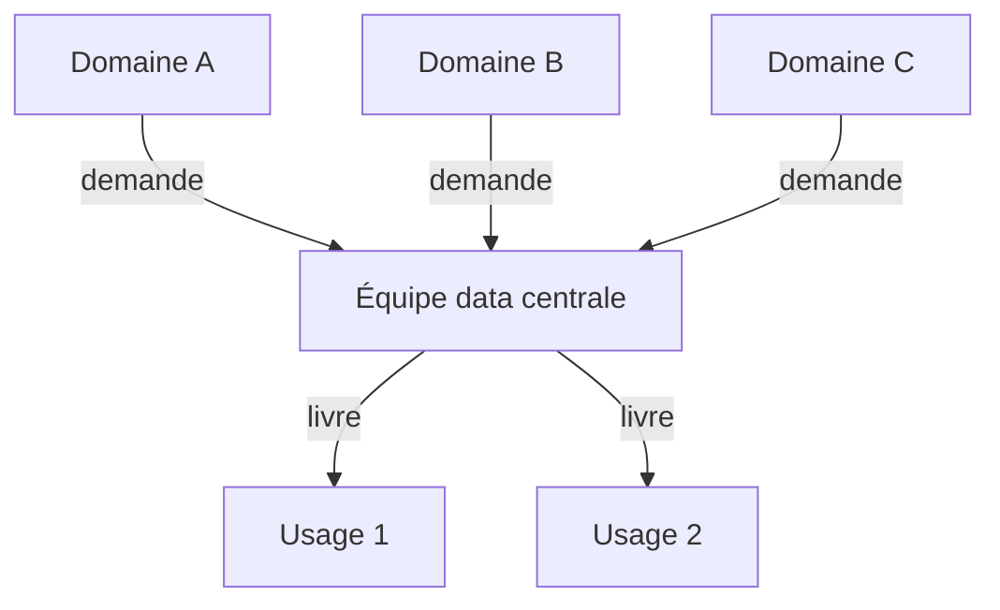
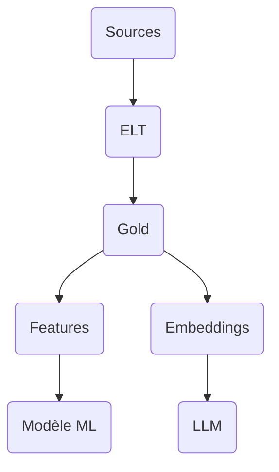

---
layout: default
---

# Cours précédent

- Utilisateur·rice·s, rôles et privilèges
- `GRANT`, `REVOKE` et moindre privilège
- Suppression physique ou logique
- Sauvegarde et restauration : `pg_dump`, `pg_restore`

<Card title="Aujourd'hui" color="#e92528">
<template #icon><pixelarticons-git-branch /></template>
Au-delà du relationnel : JSONB et index de PostgreSQL, NoSQL, systèmes distribués, flux de données et architectures.
</Card>

---
layout: section
---

# Au-delà du relationnel

---
layout: two-cols
---

::title::
# Limites du relationnel

::left::

- Idéal : données structurées, stables, cohérentes
- Schéma qui change souvent : migrations coûteuses
- Données imbriquées, attributs optionnels nombreux
- Mise à l'échelle horizontale
- Usages spécialisés : graphe, séries temporelles

::right::

<Figure
  src="/images/05/nosql-design-principles-diagram.webp"
  caption="ScyllaDB, <a href='https://www.scylladb.com/glossary/nosql-design-principles/'><em>NoSQL Design Principles</em></a>"
  alt="Principes de conception NoSQL"
/>

---
layout: two-cols
class: compact
---

::title::
# Familles de structures

::left::

| Type | Usage | Exemples |
|---|---|---|
| Relationnel | OLTP, cohérence forte | PostgreSQL, MySQL |
| Document | Contenus variables | MongoDB, CouchDB |
| Clé-valeur | Cache, sessions | Redis, Memcached |
| Colonnes larges | IoT, journaux | Cassandra, HBase |
| Graphe | Réseaux, recommandations | Neo4j |
| Recherche | Plein texte | Elasticsearch |

::right::

<Figure
  src="/images/05/NoSQL-database-types.svg"
  caption="MongoDB, <a href='https://www.mongodb.com/resources/basics/databases/nosql-explained'><em>What is NoSQL?</em></a>"
  alt="Types de bases NoSQL"
/>

---
layout: section
---

# PostgreSQL au-delà des tables

---
layout: grid
cols: 2
align: stretch
content: center
---

# Types étendus de PostgreSQL

<Card title="JSONB">
<template #icon><pixelarticons-braces /></template>
Documents JSON stockés et indexés dans une colonne.
</Card>
<Card title="Tableaux">
<template #icon><pixelarticons-list /></template>
Plusieurs valeurs dans une cellule : <code>TEXT[]</code>.
</Card>
<Card title="PostGIS">
<template #icon><pixelarticons-map /></template>
Points, lignes, polygones et calculs de distance.
</Card>
<Card title="Plein texte">
<template #icon><pixelarticons-search /></template>
Recherche par mots avec <code>tsvector</code>.
</Card>

Relationnel et semi-structuré dans la même base.

---
layout: two-cols
references: "PostgreSQL, <em>JSON Functions and Operators</em>"
---

::title::
# Syntaxe : JSONB

::left::

- Type `JSONB` : JSON stocké en binaire
- `->` : extraire un élément en JSONB
- `->>` : extraire un élément en texte
- `@>` : le document contient-il ce fragment ?

::right::

```sql
CREATE TABLE table_name (
  id        INTEGER PRIMARY KEY,
  attributs JSONB
);

SELECT attributs -> 'cle'    FROM table_name;
SELECT attributs ->> 'cle'   FROM table_name;

SELECT * FROM table_name
WHERE attributs @> '{"cle": "valeur"}';
```

---
layout: two-cols
---

::title::
# Exemple : attributs du *mobilier*

::left::

### Besoins

> « Un lampadaire a une puissance, un banc un matériau, une borne un type de prise. »

### La question

Comment stocker des attributs différents par type ?

::right::

<v-click>

```sql
ALTER TABLE mobilier
  ADD COLUMN attributs JSONB;

UPDATE mobilier
SET attributs = '{"puissance_w": 150,
                  "technologie": "LED"}'
WHERE id = 42;

SELECT id, attributs ->> 'technologie'
FROM mobilier
WHERE attributs @> '{"technologie": "LED"}';
```

</v-click>

<v-click>

- Une colonne pour les attributs variables
- Les colonnes communes restent relationnelles

</v-click>

---
layout: default
references: "PostgreSQL, <em>Index Types</em>"
---

# Index de PostgreSQL

| Type | Usage | Syntaxe |
|---|---|---|
| B-tree | Défaut : `=`, `<`, `>`, tri | `CREATE INDEX ... ON t (col)` |
| Hash | Égalité seule | `USING hash (col)` |
| GIN | JSONB, tableaux, plein texte | `USING gin (col)` |
| GiST, SP-GiST | Données spatiales, proximité | `USING gist (col)` |

<Card color="#6b7280" tag="note" title="Rappel ModelDon">
<template #icon><pixelarticons-book-open /></template>
Index B-tree, plan d'exécution, coût d'un index à l'écriture.
</Card>

---
layout: two-cols
references: "PostgreSQL, <em>GIN Indexes</em>"
---

::title::
# Index GIN

::left::

- Index **inversé** : valeur, puis lignes qui la contiennent
- JSONB, tableaux, plein texte
- Écriture plus lente, index plus lourd

```sql
CREATE INDEX idx_mobilier_attributs
  ON mobilier USING gin (attributs);
```

::right::

<Figure
  src="/images/05/gin_livre.svg"
  alt="Index GIN comme l'index d'un livre"
/>

---
layout: two-cols
references: "PostgreSQL, <em>GiST Indexes</em>"
---

::title::
# Index GiST

::left::

- Découpe l'espace en zones imbriquées
- Données spatiales PostGIS
- Proximité, chevauchement, distance

```sql
CREATE INDEX idx_mobilier_geom
  ON mobilier USING gist (geom);
```

::right::

<Figure
  src="/images/05/spgist_ville.svg"
  alt="Index spatial comme un plan de ville découpé en quartiers"
/>

---
layout: two-cols
references: "PostgreSQL, <em>EXPLAIN</em>"
---

::title::
# Syntaxe : EXPLAIN ANALYZE

::left::

- Plan d'exécution **réel** de la requête
- `ANALYZE` : la requête est exécutée
- Temps et lignes de chaque étape
- `Seq Scan` ou `Index Scan`

::right::

```sql
EXPLAIN ANALYZE
SELECT * FROM table_name
WHERE colonne = 'valeur';

EXPLAIN (ANALYZE, BUFFERS)
SELECT ...;
```

---
layout: default
class: compact
---

# Lecture d'un plan

```text
Seq Scan on interventions  (cost=0.00..2450.00 rows=12 width=80)
                           (actual time=0.021..18.340 rows=12 loops=1)
  Filter: (mobilier_id = 42)
  Rows Removed by Filter: 99988
Execution Time: 18.361 ms
```

| Champ | Signification |
|---|---|
| `cost` | Coût estimé, en unités arbitraires |
| `rows` | Lignes estimées par le planificateur |
| `actual time` | Temps réel, en millisecondes |
| `Rows Removed by Filter` | Lignes lues pour rien : index manquant |

---
layout: two-cols
---

::title::
# Exemple : interventions d'un objet

::left::

### Besoins

> « La fiche d'un lampadaire met plusieurs secondes à s'afficher. »

### La question

Où la requête perd-elle son temps ?

::right::

<v-click>

```sql
CREATE INDEX idx_interventions_mobilier
  ON interventions (mobilier_id);

EXPLAIN ANALYZE
SELECT * FROM interventions
WHERE mobilier_id = 42;
```

```text
Index Scan using idx_interventions_mobilier
  Index Cond: (mobilier_id = 42)
Execution Time: 0.063 ms
```

</v-click>

<v-click>

- Avant : `Seq Scan`, toute la table lue
- Après : `Index Scan`, lecture directe

</v-click>

---
layout: two-cols
---

::title::
# Index d'expression

::left::

- Fonction sur la colonne : index ignoré
- `LOWER(email)` n'est pas `email`
- Indexer l'expression exacte

::right::

```sql
-- Index sur email ignoré : Seq Scan
EXPLAIN ANALYZE
SELECT * FROM fournisseurs
WHERE LOWER(email) = 'contact@exemple.ch';

CREATE INDEX idx_fournisseurs_email_lower
  ON fournisseurs (LOWER(email));
```

---
layout: section
---

# NoSQL

---
layout: two-cols
---

::title::
# Not Only SQL

::left::

- Complète le relationnel, ne le remplace pas
- Schémas variables ou inconnus
- Volumes massifs, mise à l'échelle horizontale
- Structures non tabulaires
- Accès très rapides par clé

::right::

<Figure
  src="/images/05/NoSQL-Features.svg"
  caption="MongoDB, <a href='https://www.mongodb.com/resources/basics/databases/nosql-explained'><em>What is NoSQL?</em></a>"
  alt="Caractéristiques des bases NoSQL"
/>

---
layout: two-cols
references: "MongoDB, <em>NoSQL Explained</em>"
---

::title::
# Base document

::left::

- Un enregistrement : un **document** JSON
- Schéma souple, champs différents par document
- **+** Imbrication native, peu de jointures
- **-** Redondance, cohérence plus difficile
- MongoDB, CouchDB

::right::

```json
{
  "id": "mobilier_042",
  "type": "lampadaire",
  "quartier": "Villette",
  "attributs": {
    "puissance_w": 150,
    "technologie": "LED"
  },
  "signalements": [
    {
      "date": "2024-03-01",
      "motif": "panne"
    }
  ]
}
```

---
layout: two-cols
references: "Redis, <em>Documentation</em>"
---

::title::
# Base clé-valeur

::left::

- Une **clé** unique, une **valeur** quelconque
- Accès en temps constant
- **+** Latence sous la milliseconde
- **-** Pas de requête, pas de filtre
- Redis, Memcached

::right::

| Clé | Valeur |
|---|---|
| `session:user_42` | Rôle et expiration |
| `compteur:signalements` | 847 |
| `cache:mobilier:42` | Résultat d'une requête |

---
layout: two-cols
class: compact
references: "Apache Cassandra, <em>Documentation</em>"
---

::title::
# Colonnes larges

::left::

- Colonnes regroupées en **familles**
- Chaque ligne a ses propres colonnes
- **+** Écriture massive, sans point unique de panne
- **-** Pas de jointure, requêtes prévues d'avance
- Cassandra, HBase

::right::

`mesures`

| clé | info:type | m:03-01 | m:03-02 |
|---|---|---|---|
| capteur_001 | lampadaire | 145 W | 152 W |
| capteur_002 | fontaine | | actif |
| capteur_003 | banc | ok | |

---
layout: two-cols
references: "Neo4j, <em>Documentation</em>"
---

::title::
# Base graphe

::left::

- **Nœuds**, **arêtes**, propriétés
- Les relations sont des données
- **+** Requêtes à plusieurs sauts
- **-** Très grands graphes difficiles à répartir
- Neo4j

::right::

```cypher
MATCH (p:Personne)
      -[:A_SIGNALE]->(s:Signalement)
      -[:CONCERNE]->(m:Mobilier {id: 12})
RETURN p.nom, s.date, s.motif
```

<Figure
  src="/images/05/graph-database.png"
  alt="Nœuds et relations d'une base graphe"
/>

---
layout: default
---

# Choix d'une structure

| Besoin | Structure |
|---|---|
| Relations et cohérence forte | Relationnel |
| Contenu variable, documents imbriqués | Document |
| Cache, sessions, accès par clé | Clé-valeur |
| Métriques, journaux, IoT à grande échelle | Colonnes larges |
| Réseaux, recommandations | Graphe |
| Recherche textuelle, autocomplétion | Recherche |

La plupart des systèmes combinent plusieurs structures.

---
layout: section
---

# Systèmes distribués

---
layout: two-cols
---

::title::
# Système distribué

::left::

- Plusieurs **nœuds** reliés par un réseau
- Réplication entre nœuds
- Plus de machines plutôt que plus grosses
- Pannes réseau inévitables

::right::

<Card color="#6b7280" tag="note" title="Hors du cadre">
<template #icon><pixelarticons-server /></template>
Un PostgreSQL sur une seule machine n'est pas distribué : CAP et BASE ne le concernent pas.
</Card>

---
layout: two-cols
references:
  - "Hazelcast, <em>CAP Theorem</em>"
  - "Kleppmann, <em>Please stop calling databases CP or AP</em> (2015)"
---

::title::
# Théorème CAP

::left::

- **C**ohérence : tous les nœuds voient la même donnée
- **D**isponibilité : toute requête reçoit une réponse
- **P**artition : fonctionne malgré une coupure réseau
- Au plus deux sur trois
- Partition inévitable : choisir **CP** ou **AP**

::right::

<Figure
  src="/images/05/cap-theorem.webp"
  alt="Théorème CAP"
/>

---
layout: two-cols
---

::title::
# BASE

::left::

- **B**asically **A**vailable : répond toujours
- **S**oft state : l'état se propage
- **E**ventually consistent : convergence à terme
- Alternative à ACID pour la haute disponibilité

::right::

| Usage | Comportement |
|---|---|
| DNS | Propagation en quelques heures |
| Compteur de mentions | Synchronisé par lots |
| Panier d'achat | Visible localement d'abord |
| Cache CDN | Ancien jusqu'au rafraîchissement |

---
layout: section
---

# OLTP et OLAP

---
layout: two-cols
---

::title::
# Deux usages des données

::left::

### OLTP

- Nombreuses petites transactions
- Données actuelles, modèle normalisé
- ACID indispensable
- Enregistrer un signalement

::right::

### OLAP

- Peu de requêtes, très volumineuses
- Historique, agrégats, modèle dénormalisé
- Cohérence à terme souvent suffisante
- Rapport annuel des coûts

---
layout: two-cols
---

::title::
# Rapport et saisie

::left::

### Situation

> « À 8h45, j'ai lancé le rapport des coûts sur cinq ans. Le technicien a mis 45 secondes à saisir un signalement urgent. »

### La question

Pourquoi, et comment l'éviter ?

::right::

<v-click>

<Card title="Cause" color="#e92528">
<template #icon><pixelarticons-alert /></template>
La requête analytique lit toute la table et monopolise les ressources des petites écritures.
</Card>

</v-click>

<v-click>

<Card title="Solutions" color="#16a34a">
<template #icon><pixelarticons-check /></template>
Réplique en lecture pour l'analyse. Entrepôt de données séparé. Vue matérialisée calculée la nuit.
</Card>

</v-click>

---
layout: two-cols
---

::title::
# Normalisation et dénormalisation

::left::

- **Normaliser** : pas de redondance, écriture sûre
- **Dénormaliser** : données pré-jointes, lecture rapide
- Redondance assumée et contrôlée
- Vues : interface stable entre schéma et usages

::right::

<Figure
  src="/images/05/denormalisation.jpg"
  alt="Normalisation et dénormalisation"
/>

---
layout: two-cols
references: "PostgreSQL, <em>Materialized Views</em>"
---

::title::
# Syntaxe : vue matérialisée

::left::

- Résultat de la requête **stocké**
- Lecture rapide, comme une table
- Données figées jusqu'au rafraîchissement
- `CONCURRENTLY` : sans bloquer les lectures

::right::

```sql
CREATE MATERIALIZED VIEW nom_vue AS
SELECT ...;

REFRESH MATERIALIZED VIEW nom_vue;

-- Nécessite un index UNIQUE sur la vue
REFRESH MATERIALIZED VIEW
  CONCURRENTLY nom_vue;
```

---
layout: two-cols
---

::title::
# Exemple : coûts par type

::left::

### Besoins

> « Je consulte chaque matin les coûts par type de mobilier. Les chiffres de la veille suffisent. »

### La question

Comment éviter de recalculer à chaque consultation ?

::right::

<v-click>

```sql
CREATE MATERIALIZED VIEW couts_par_type AS
SELECT m.type,
       SUM(i.cout) AS cout_total,
       COUNT(*)    AS nb_interventions
FROM interventions AS i
JOIN mobilier AS m ON m.id = i.mobilier_id
GROUP BY m.type;

REFRESH MATERIALIZED VIEW couts_par_type;
```

</v-click>

<v-click>

- Calcul une fois, lectures instantanées
- Rafraîchissement planifié la nuit

</v-click>

---
layout: section
---

# Flux de données

---
layout: default
---

# Pipeline de données

- Sources multiples : API, fichiers, bases opérationnelles
- Transformations pour rendre la donnée exploitable
- Destinations : entrepôts, tableaux de bord, modèles d'IA
- Changements continus

<Card title="Pipeline" color="#e92528">
<template #icon><pixelarticons-repeat /></template>
Suite d'étapes qui collecte, transforme et livre la donnée, de la source à la destination.
</Card>

---
layout: grid
cols: 3fr 1fr 3fr 1fr 3fr
align: stretch
content: center
---

# ETL : Extract, Transform, Load

<Card title="Sources">
<template #icon><pixelarticons-file-alt /></template>
Excel, API, CSV
</Card>
<pixelarticons-arrow-right class="text-3xl self-center" />
<Card title="Transform">
<template #icon><pixelarticons-filter /></template>
Outil externe : nettoyage, jointures
</Card>
<pixelarticons-arrow-right class="text-3xl self-center" />
<Card title="Load" color="#e92528">
<template #icon><pixelarticons-database /></template>
Entrepôt, données propres
</Card>

<strong>+</strong> Données propres dès l'arrivée · <strong>-</strong> Données brutes perdues · Airflow, Talend, FME

---
layout: grid
cols: 3fr 1fr 3fr 1fr 3fr 1fr 3fr
align: stretch
content: center
---

# ELT : Extract, Load, Transform

<Card title="Sources">
<template #icon><pixelarticons-file-alt /></template>
Excel, API, CSV
</Card>
<pixelarticons-arrow-right class="text-3xl self-center" />
<Card title="Load">
<template #icon><pixelarticons-inbox /></template>
Tables de staging brutes
</Card>
<pixelarticons-arrow-right class="text-3xl self-center" />
<Card title="Transform">
<template #icon><pixelarticons-filter /></template>
SQL dans la base
</Card>
<pixelarticons-arrow-right class="text-3xl self-center" />
<Card title="Tables finales" color="#e92528">
<template #icon><pixelarticons-database /></template>
Données exploitables
</Card>

<strong>+</strong> Données brutes conservées, transformations rejouables · <strong>-</strong> Destination puissante requise

---
layout: default
---

# ETL et ELT

| Critère | ETL | ELT |
|---|---|---|
| Ordre | Extract, Transform, Load | Extract, Load, Transform |
| Données brutes | Perdues | Conservées en staging |
| Transformation | Outil externe | SQL dans la destination |
| Rejouer | Difficile | Facile |
| Usage typique | Entrepôt traditionnel | Entrepôt cloud |

<Card title="Dans le projet" color="#e92528">
<template #icon><pixelarticons-check /></template>
Vos tables de staging et le nettoyage SQL forment un pipeline <strong>ELT</strong>.
</Card>

---
layout: section
---

# Stockage analytique

---
layout: two-cols
references: "GeeksforGeeks, <em>Data Warehousing</em>"
---

::title::
# Entrepôt de données

::left::

- Base centrale pour l'**analyse**
- Données de plusieurs systèmes, nettoyées
- Schéma fixe, optimisé OLAP
- **+** Requêtes analytiques rapides
- **-** Schéma rigide, coûteux à faire évoluer

::right::

<Figure
  src="/images/05/data_warehouse-660.webp"
  alt="Architecture d'un entrepôt de données"
/>

---
layout: two-cols
references: "Qlik, <em>What is a Data Lake?</em>"
---

::title::
# Lac de données

::left::

- Toutes les données **brutes**, tout format
- Schéma défini à la lecture
- **+** Stockage bon marché, idéal pour le ML
- **-** Sans gouvernance : un marécage de données

::right::

<Figure
  src="/images/05/data-lake.png"
  alt="Architecture d'un lac de données"
/>

---
layout: two-cols
references: "Databricks, <em>Medallion Architecture</em>"
---

::title::
# Architecture Medallion

::left::

- **Bronze** : données brutes, telles que reçues
- **Silver** : nettoyées, typées, dédoublonnées
- **Gold** : agrégées, prêtes pour l'analyse
- Qualité croissante d'une couche à l'autre

::right::

<Figure
  src="/images/05/Medallion-Architecture.png"
  caption="<a href='https://www.flexera.com/blog/finops/medallion-architecture/'>Flexera, <em>Medallion Architecture</em></a>"
  alt="Couches bronze, silver et gold"
/>

---
layout: two-cols
references: "Armbrust et al., <em>Lakehouse</em> (CIDR 2021)"
---

::title::
# Lakehouse

::left::

- Lac de données et fiabilité d'un entrepôt
- Transactions ACID sur des fichiers
- Catalogue de métadonnées, lignage
- Versions : interroger un état passé
- Delta Lake, Apache Iceberg, Apache Hudi

::right::

<Figure
  src="/images/05/data-lake-house.png"
  caption="<a href='https://www.qlik.com/us/data-lake/data-lakehouse'>Qlik, <em>Data lakehouse</em></a>"
  alt="Architecture lakehouse"
/>

---
layout: section
---

# Gouvernance des données

---
layout: two-cols
---

::title::
# Architecture centralisée

::left::

- Une seule équipe data : goulot d'étranglement
- Délais longs, qualité inégale
- Pipelines monolithiques et fragiles
- Réponses : lakehouse et data mesh

::right::



---
layout: two-cols
references:
  - "Dehghani, <em>How to Move Beyond a Monolithic Data Lake</em> (2019)"
  - "Evans, <em>Domain-Driven Design</em> (2003)"
  - "Pais et Skelton, <em>Team Topologies</em> (2019)"
---

::title::
# Data mesh

::left::

- Proposé par Zhamak Dehghani en 2019
- Approche **sociotechnique** et décentralisée
- Chaque domaine métier gère ses données
- Une équipe plateforme fournit les outils
- Bases : Domain-Driven Design, Team Topologies

::right::

<Figure
  src="https://martinfowler.com/articles/data-mesh-principles/architecture.png"
  caption="<a href='https://martinfowler.com/articles/data-mesh-principles.html'>martinfowler.com, <em>Data Mesh Principles</em></a>"
  alt="Architecture data mesh"
/>

---
layout: grid
cols: 2
align: stretch
content: center
references: "Dehghani, <em>Data Mesh Principles</em>, martinfowler.com"
---

# Principes du data mesh

<Card title="Domaine propriétaire">
<template #icon><pixelarticons-home /></template>
Chaque domaine est responsable de ses données. L'équipe mobilier gère le mobilier.
</Card>
<Card title="Donnée comme produit">
<template #icon><pixelarticons-package /></template>
Un propriétaire, des usages, un cycle de vie. Découvrable, fiable, documentée.
</Card>
<Card title="Plateforme en libre-service">
<template #icon><pixelarticons-tool-case /></template>
Catalogue, pipelines, monitoring communs. Aucune dépendance à une équipe centrale.
</Card>
<Card title="Gouvernance fédérée">
<template #icon><pixelarticons-users /></template>
Règles globales automatisées, choix locaux libres : schéma, format, fréquence.
</Card>

---
layout: two-cols
class: compact
references: "Dehghani, <em>Data Mesh Principles</em>, martinfowler.com"
---

::title::
# Gouvernance fédérée

::left::

| | Centralisée | Data mesh |
|---|---|---|
| Décision | Équipe centrale | Représentant·e·s des domaines |
| Qualité | Équipe centrale | Chaque domaine, à la source |
| Sécurité | Manuelle | Automatisée par la plateforme |
| Modèle | Schéma unique | Schéma par domaine |
| Succès | Volume catalogué | Usage entre domaines |

::right::

<Figure
  src="https://martinfowler.com/articles/data-mesh-principles/governance.png"
  caption="<a href='https://martinfowler.com/articles/data-mesh-principles.html'>martinfowler.com, <em>Data Mesh Principles</em></a>"
  alt="Gouvernance fédérée du data mesh"
/>

---
layout: section
---

# Données et IA

---
layout: two-cols
---

::title::
# Infrastructure pour l'IA

::left::

- Les données Gold alimentent les modèles
- **RAG** : un LLM interroge les données internes
- Recherche dans une base vectorielle
- Documents injectés dans le contexte du modèle
- Un modèle ne vaut pas mieux que ses données

::right::



---
layout: grid
cols: 3
align: stretch
content: center
---

# Métiers de la donnée

<Card title="Data engineer">
<template #icon><pixelarticons-repeat /></template>
Construit et maintient les pipelines. SQL, Python, Airflow, dbt.
</Card>
<Card title="Data architect">
<template #icon><pixelarticons-layout /></template>
Conçoit l'architecture, les standards et la gouvernance.
</Card>
<Card title="Analytics engineer">
<template #icon><pixelarticons-table /></template>
Transforme les données brutes en modèles fiables et documentés.
</Card>
<Card title="Data analyst">
<template #icon><pixelarticons-chart-bar /></template>
Explore les données, produit rapports et tableaux de bord.
</Card>
<Card title="Data scientist">
<template #icon><pixelarticons-lightbulb /></template>
Développe des modèles statistiques et d'apprentissage.
</Card>
<Card title="ML engineer">
<template #icon><pixelarticons-robot /></template>
Met les modèles en production et surveille leur dérive.
</Card>

---
layout: image-full
image: /images/05/data-engineering-landscape.webp
---

---
layout: section
---

# Travaux pratiques

---
layout: two-cols
routeAlias: tp
---

::title::
# Travail pratique · Semaine 5

::left::

### J4 · Vues et performance

1. Qualifier le brief : OLTP, OLAP ou les deux
2. Écrire les vues métier du brief
3. Matérialiser la vue la plus coûteuse
4. `EXPLAIN ANALYZE` avant et après un index

::right::

### Pipeline

1. Documenter le pipeline ELT en place
2. Identifier les transformations de chaque étape
3. Proposer une structure alternative et la justifier

---
layout: default
---

# Ressources

- [PostgreSQL · JSON Types](https://www.postgresql.org/docs/current/datatype-json.html)
- [PostgreSQL · Index Types](https://www.postgresql.org/docs/current/indexes-types.html)
- [PostgreSQL · EXPLAIN](https://www.postgresql.org/docs/current/using-explain.html)
- [PostgreSQL · Materialized Views](https://www.postgresql.org/docs/current/rules-materializedviews.html)
- [Data Mesh Principles](https://martinfowler.com/articles/data-mesh-principles.html)

<Card title="Prochain cours" color="#e92528" footer="cours 06 · Éthique des données">
<template #icon><pixelarticons-arrow-right /></template>
Impact environnemental, biais, souveraineté, nLPD et RGPD.
</Card>
