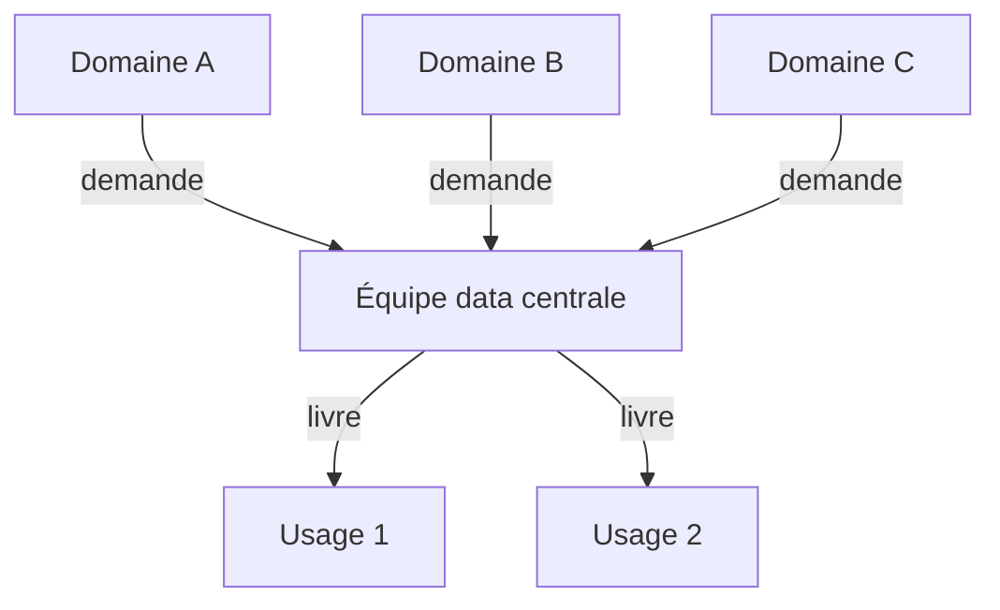

---
layout: default
---

# Cours précédent

- Rôles, `GRANT`, `REVOKE`, moindre privilège, audit des rôles
- Suppression physique ou logique
- RPO, RTO, dump, WAL, réplication
- Sauvegarde et restauration : `pg_dump`, `pg_restore`

<Card title="Aujourd'hui" color="#e92528">
<template #icon><pixelarticons-git-branch /></template>
Limites du relationnel, NoSQL, OLTP et OLAP, architectures analytiques, et choix de la solution la plus simple.
</Card>

---
layout: section
---

# Au-delà du relationnel

---
layout: two-cols
---

::title::
# Limites du relationnel

::left::

- Idéal : données structurées, stables, cohérentes
- Schéma qui change souvent : migrations coûteuses
- Données imbriquées, attributs optionnels nombreux
- Mise à l'échelle horizontale
- Usages spécialisés : graphe, séries temporelles

::right::

<Figure
  src="/images/05/nosql-design-principles-diagram.webp"
  caption="ScyllaDB, <a href='https://www.scylladb.com/glossary/nosql-design-principles/'><em>NoSQL Design Principles</em></a>"
  alt="Principes de conception NoSQL"
/>

---
layout: grid
cols: 2
align: stretch
content: center
---

# Types étendus de PostgreSQL

<Card title="JSONB">
<template #icon><pixelarticons-braces /></template>
Documents JSON stockés et indexés dans une colonne.
</Card>
<Card title="Tableaux">
<template #icon><pixelarticons-list /></template>
Plusieurs valeurs dans une cellule : <code>TEXT[]</code>.
</Card>
<Card title="PostGIS">
<template #icon><pixelarticons-map /></template>
Points, lignes, polygones et calculs de distance.
</Card>
<Card title="Plein texte">
<template #icon><pixelarticons-search /></template>
Recherche par mots avec <code>tsvector</code>.
</Card>

Relationnel et semi-structuré dans la même base.

---
layout: default
---

# Colonnes, JSONB, base document

| Critère | Colonnes | JSONB | Base document |
|---|---|---|---|
| Schéma | Fixe | Souple, par ligne | Souple, par document |
| Contraintes | Natives | Limitées | Selon le moteur |
| Jointures | Natives | Sur les colonnes communes | Limitées |
| Usage | Attributs communs | Attributs variables | Documents autonomes |

---
layout: section
---

# NoSQL

---
layout: two-cols
---

::title::
# Not Only SQL

::left::

- Complète le relationnel, ne le remplace pas
- Schémas variables ou inconnus
- Volumes massifs, mise à l'échelle horizontale
- Structures non tabulaires
- Accès très rapides par clé

::right::

<Figure
  src="/images/05/NoSQL-Features.svg"
  caption="MongoDB, <a href='https://www.mongodb.com/resources/basics/databases/nosql-explained'><em>What is NoSQL?</em></a>"
  alt="Caractéristiques des bases NoSQL"
/>

---
layout: two-cols
class: compact
---

::title::
# Familles de structures

::left::

| Type | Usage | Exemples |
|---|---|---|
| Relationnel | OLTP, cohérence forte | PostgreSQL, MySQL |
| Document | Contenus variables | MongoDB, CouchDB |
| Clé-valeur | Cache, sessions | Redis, Memcached |
| Colonnes larges | IoT, journaux | Cassandra, HBase |
| Graphe | Réseaux, recommandations | Neo4j |
| Recherche | Plein texte | Elasticsearch |

::right::

<Figure
  src="/images/05/NoSQL-database-types.svg"
  caption="MongoDB, <a href='https://www.mongodb.com/resources/basics/databases/nosql-explained'><em>What is NoSQL?</em></a>"
  alt="Types de bases NoSQL"
/>

---
layout: default
---

# Forces et limites du NoSQL

| Type | Force | Limite |
|---|---|---|
| Document | Imbrication native, peu de jointures | Redondance, cohérence plus difficile |
| Clé-valeur | Latence très faible | Pas de requête, pas de filtre |
| Colonnes larges | Écriture massive, sans point unique de panne | Requêtes prévues d'avance |
| Graphe | Requêtes à plusieurs sauts | Très grands graphes difficiles à répartir |

La plupart des systèmes combinent plusieurs structures.

---
layout: section
---

# Systèmes distribués

---
layout: two-cols
---

::title::
# Système distribué

::left::

- Plusieurs **nœuds** reliés par un réseau
- Réplication entre nœuds
- Plus de machines plutôt que plus grosses
- Pannes réseau inévitables

::right::

<Card color="#6b7280" tag="note" title="Hors du cadre">
<template #icon><pixelarticons-server /></template>
Un PostgreSQL sur une seule machine n'est pas distribué : CAP et BASE ne le concernent pas.
</Card>

---
layout: two-cols
references:
  - "Hazelcast, <em>CAP Theorem</em>"
  - "Kleppmann, <em>Please stop calling databases CP or AP</em> (2015)"
---

::title::
# Théorème CAP

::left::

- **C**ohérence : tous les nœuds voient la même donnée
- **D**isponibilité : toute requête reçoit une réponse
- **P**artition : fonctionne malgré une coupure réseau
- Au plus deux sur trois
- Partition inévitable : choisir **CP** ou **AP**

::right::

<Figure
  src="/images/05/cap-theorem.webp"
  alt="Théorème CAP"
/>

---
layout: two-cols
---

::title::
# BASE

::left::

- **B**asically **A**vailable : répond toujours
- **S**oft state : l'état se propage
- **E**ventually consistent : convergence à terme
- Alternative à ACID pour la haute disponibilité

::right::

| Usage | Comportement |
|---|---|
| DNS | Propagation en quelques heures |
| Compteur de mentions | Synchronisé par lots |
| Panier d'achat | Visible localement d'abord |
| Cache CDN | Ancien jusqu'au rafraîchissement |

---
layout: section
---

# OLTP et OLAP

---
layout: two-cols
---

::title::
# Deux usages des données

::left::

### OLTP

- Nombreuses petites transactions
- Données actuelles, modèle normalisé
- ACID indispensable
- Enregistrer un signalement

::right::

### OLAP

- Peu de requêtes, très volumineuses
- Historique, agrégats, modèle dénormalisé
- Cohérence à terme souvent suffisante
- Rapport annuel des coûts

---
layout: two-cols
---

::title::
# Rapport et saisie

::left::

### Situation

> « À 8h45, j'ai lancé le rapport des coûts sur cinq ans. Le technicien a mis 45 secondes à saisir un signalement urgent. »

### Question

Pourquoi, et comment l'éviter ?

::right::

<v-click>

<Card title="Cause" color="#e92528">
<template #icon><pixelarticons-alert /></template>
La requête analytique lit toute la table et monopolise les ressources des petites écritures.
</Card>

</v-click>

<v-click>

<Card title="Solutions" color="#16a34a">
<template #icon><pixelarticons-check /></template>
Réplique en lecture pour l'analyse. Entrepôt de données séparé. Vue matérialisée calculée la nuit.
</Card>

</v-click>

---
layout: section
---

# Flux et stockage analytique

---
layout: default
---

# ETL et ELT

| Critère | ETL | ELT |
|---|---|---|
| Ordre | Extract, Transform, Load | Extract, Load, Transform |
| Données brutes | Perdues | Conservées en staging |
| Transformation | Outil externe | SQL dans la destination |
| Rejouer | Difficile | Facile |

<Card title="Rappel du cours 02" color="#e92528">
<template #icon><pixelarticons-check /></template>
La staging et le nettoyage SQL forment un pipeline <strong>ELT</strong>.
</Card>

---
layout: default
---

# Entrepôt, lac, lakehouse

| Critère | Entrepôt | Lac de données | Lakehouse |
|---|---|---|---|
| Données | Nettoyées | Brutes, tout format | Brutes et nettoyées |
| Schéma | Fixe, à l'écriture | Défini à la lecture | Souple, avec catalogue |
| Force | Requêtes analytiques rapides | Stockage bon marché | Transactions ACID sur fichiers |
| Limite | Coûteux à faire évoluer | Marécage sans gouvernance | Plateforme à exploiter |

---
layout: two-cols
references: "Armbrust et al., <em>Lakehouse</em> (CIDR 2021)"
---

::title::
# Lakehouse

::left::

- Lac de données et fiabilité d'un entrepôt
- Transactions ACID sur des fichiers
- Catalogue de métadonnées, lignage
- Versions : interroger un état passé
- Delta Lake, Apache Iceberg, Apache Hudi

::right::

<Figure
  src="/images/05/data-lake-house.png"
  caption="<a href='https://www.qlik.com/us/data-lake/data-lakehouse'>Qlik, <em>Data lakehouse</em></a>"
  alt="Architecture lakehouse"
/>

---
layout: two-cols
references: "Databricks, <em>Medallion Architecture</em>"
---

::title::
# Architecture Medallion

::left::

- **Bronze** : données brutes, telles que reçues
- **Silver** : nettoyées, typées, dédoublonnées
- **Gold** : agrégées, prêtes pour l'analyse
- Qualité croissante d'une couche à l'autre

::right::

<Figure
  src="/images/05/Medallion-Architecture.png"
  caption="<a href='https://www.flexera.com/blog/finops/medallion-architecture/'>Flexera, <em>Medallion Architecture</em></a>"
  alt="Couches bronze, silver et gold"
/>

---
layout: section
---

# Organisation des données

---
layout: two-cols
---

::title::
# Architecture centralisée

::left::

- Une seule équipe data : goulot d'étranglement
- Délais longs, qualité inégale
- Pipelines monolithiques et fragiles

::right::



---
layout: two-cols
references:
  - "Dehghani, <em>How to Move Beyond a Monolithic Data Lake</em> (2019)"
  - "Evans, <em>Domain-Driven Design</em> (2003)"
  - "Pais et Skelton, <em>Team Topologies</em> (2019)"
---

::title::
# Data mesh

::left::

- Proposé par Zhamak Dehghani en 2019
- Approche **sociotechnique** et décentralisée
- Chaque domaine métier gère ses données
- Une équipe plateforme fournit les outils
- Bases : Domain-Driven Design, Team Topologies

::right::

<Figure
  class="w-2/3 mx-auto"
  src="https://martinfowler.com/articles/data-mesh-principles/architecture.png"
  caption="<a href='https://martinfowler.com/articles/data-mesh-principles.html'>martinfowler.com, <em>Data Mesh Principles</em></a>"
  alt="Architecture data mesh"
/>

---
layout: grid
cols: 2
align: stretch
content: center
references: "Dehghani, <em>Data Mesh Principles</em>, martinfowler.com"
---

# Principes du data mesh

<Card title="Domaine propriétaire">
<template #icon><pixelarticons-home /></template>
Chaque domaine est responsable de ses données. L'équipe mobilier gère le mobilier.
</Card>
<Card title="Donnée comme produit">
<template #icon><pixelarticons-package /></template>
Un propriétaire, des usages, un cycle de vie. Découvrable, fiable, documentée.
</Card>
<Card title="Plateforme en libre-service">
<template #icon><pixelarticons-tool-case /></template>
Catalogue, pipelines, monitoring communs. Aucune dépendance à une équipe centrale.
</Card>
<Card title="Gouvernance fédérée">
<template #icon><pixelarticons-users /></template>
Règles globales automatisées, choix locaux libres : schéma, format, fréquence.
</Card>

---
layout: section
---

# Choix d'une architecture

---
layout: two-cols
---

::title::
# Over-engineering

::left::

- Solution plus complexe que le besoin
- Coûts : exploitation, compétences, pannes
- Complexité difficile à retirer ensuite
- Point de départ : un besoin mesuré

::right::

<Card title="Réflexe" color="#e92528">
<template #icon><pixelarticons-scale /></template>
Quelle est la solution la plus simple qui répond au besoin ? Quelle mesure prouve qu'elle ne suffit plus ?
</Card>

---
layout: default
class: compact
---

# Grille de décision

| Signal mesuré | Réponse simple | Réponse lourde |
|---|---|---|
| Attributs variables | `JSONB` | Base document |
| Rapports lents | Vue matérialisée | Entrepôt de données |
| Formats bruts multiples | Staging | Lac de données, lakehouse |
| Charge au-delà d'une machine | Réplique en lecture | Système distribué |
| Domaines autonomes | Schémas et rôles séparés | Data mesh |

Réponse lourde : seulement si la réponse simple échoue, mesures à l'appui.

---
layout: two-cols
---

::title::
# Exemple : Service technique

::left::

### Besoins

> « Quatre fichiers Excel, une petite équipe, un rapport des coûts chaque matin. Chaque type de mobilier a ses propres attributs. »

### Question

Quelle architecture, et que faut-il écarter ?

::right::

<v-click>

| Besoin | Choix |
|---|---|
| Attributs par type | `JSONB` |
| Rapport matinal | Vue matérialisée |
| Import des Excel | ELT en staging |

</v-click>

<v-click>

- Pas de lakehouse : volumes modestes
- Pas de data mesh : un seul domaine
- Réévaluer si les mesures changent

</v-click>

---
layout: section
---

# Travaux pratiques

---
layout: two-cols
routeAlias: tp
---

::title::
# Travail pratique · Semaine 5

::left::

### Déroulé

1. Colonnes contre `JSONB` : 75 min
2. Vue matérialisée : 30 min
3. Choix d'architecture : 75 min

<Card color="#6b7280" tag="note" title="Non noté">
<template #icon><pixelarticons-book-open /></template>
Les exercices préparent l'examen final.
</Card>

::right::

### Départ

1. Télécharger [05-mobilier.sql](https://comem-infradon.onrender.com/exercices/05-mobilier.sql)
2. Le copier dans le dossier `data`
3. L'exécuter dans `psql`

```sql
\i /data/05-mobilier.sql
```

---
layout: two-cols
references: "PostgreSQL, <em>JSON Functions and Operators</em>"
---

::title::
# Syntaxe : JSONB

::left::

- Type `JSONB` : JSON stocké en binaire
- `->` : extraire un élément en JSONB
- `->>` : extraire un élément en texte
- `@>` : le document contient-il ce fragment ?

::right::

```sql
CREATE TABLE table_name (
  id        INTEGER PRIMARY KEY,
  attributs JSONB
);

SELECT attributs -> 'cle'    FROM table_name;
SELECT attributs ->> 'cle'   FROM table_name;

SELECT * FROM table_name
WHERE attributs @> '{"cle": "valeur"}';
```

---
layout: two-cols
---

::title::
# Exemple : attributs du *mobilier*

::left::

### Besoins

> « Un lampadaire a une puissance, un banc un matériau, une borne un type de prise. »

### Question

Comment stocker des attributs différents par type ?

::right::

<v-click>

```sql
ALTER TABLE mobilier
  ADD COLUMN attributs JSONB;

UPDATE mobilier
SET attributs = '{"puissance_w": 150,
                  "technologie": "LED"}'
WHERE id = 42;

SELECT id, attributs ->> 'technologie'
FROM mobilier
WHERE attributs @> '{"technologie": "LED"}';
```

</v-click>

<v-click>

- Une colonne pour les attributs variables
- Les colonnes communes restent relationnelles

</v-click>

---
layout: default
references: "PostgreSQL, <em>Index Types</em>"
---

# Index de PostgreSQL

| Type | Usage | Syntaxe |
|---|---|---|
| B-tree | Défaut : `=`, `<`, `>`, tri | `CREATE INDEX ... ON t (col)` |
| Hash | Égalité seule | `USING hash (col)` |
| GIN | JSONB, tableaux, plein texte | `USING gin (col)` |
| GiST, SP-GiST | Données spatiales, proximité | `USING gist (col)` |

<Card color="#6b7280" tag="note" title="Rappel ModelDon">
<template #icon><pixelarticons-book-open /></template>
Index B-tree, plan d'exécution, coût d'un index à l'écriture.
</Card>

---
layout: two-cols
references: "PostgreSQL, <em>GIN Indexes</em>"
---

::title::
# Index GIN

::left::

- Index **inversé** : valeur, puis lignes qui la contiennent
- JSONB, tableaux, plein texte
- Écriture plus lente, index plus lourd

```sql
CREATE INDEX idx_mobilier_attributs
  ON mobilier USING gin (attributs);
```

::right::

<Figure
  src="/images/05/gin_livre.svg"
  alt="Index GIN comme l'index d'un livre"
/>

---
layout: two-cols
references: "PostgreSQL, <em>EXPLAIN</em>"
---

::title::
# Syntaxe : EXPLAIN ANALYZE

::left::

- Plan d'exécution **réel** de la requête
- `ANALYZE` : la requête est exécutée
- Temps et lignes de chaque étape
- Sans index : `Seq Scan`
- Avec index : `Index Scan` ou `Bitmap Heap Scan`

::right::

```sql
EXPLAIN ANALYZE
SELECT * FROM table_name
WHERE colonne = 'valeur';
```

---
layout: two-cols
class: compact
---

::title::
# Lecture d'un plan

::left::

| Champ | Signification |
|---|---|
| `cost` | Coût estimé, en unités arbitraires |
| `rows` | Lignes estimées par le planificateur |
| `actual time` | Temps réel, en millisecondes |
| `Rows Removed by Filter` | Lignes lues pour rien : index manquant |

::right::

```text
Seq Scan on interventions
  (cost=0.00..2450.00 rows=12)
  (actual time=0.021..18.340 rows=12)
  Filter: (mobilier_id = 42)
  Rows Removed by Filter: 99988
Execution Time: 18.361 ms
```

---
layout: two-cols
---

::title::
# Exercice 1 : colonnes et JSONB

::left::

### Étapes

1. Afficher trois lignes de chaque table
2. Compter les `technologie` vides
3. Comparer la taille des deux tables
4. Expliquer l'écart de taille

::right::

```sql
SELECT * FROM mobilier_colonnes LIMIT 3;
SELECT * FROM mobilier_jsonb LIMIT 3;

SELECT pg_size_pretty(
  pg_table_size('mobilier_colonnes')
);
```

---
layout: two-cols-bottom
---

::title::
# Exercice 2 : recherche et index

::left::

### Étapes

1. Lancer les deux requêtes avec `EXPLAIN ANALYZE`
2. Créer un index B-tree et un index GIN
3. Relancer et comparer plan et temps
4. Comparer la taille des index
5. Réécrire la seconde requête avec `->>`

::right::

```sql
SELECT id FROM mobilier_colonnes
WHERE technologie = 'solaire';

SELECT id FROM mobilier_jsonb
WHERE attributs @> '{"technologie": "solaire"}';
```

::bottom::

<Card title="Question" color="#e92528">
<template #icon><pixelarticons-scale /></template>
Quel stockage pour un attribut filtré souvent ? Et pour un attribut rare, propre à un seul type ?
</Card>

---
layout: two-cols
references: "PostgreSQL, <em>Materialized Views</em>"
---

::title::
# Syntaxe : vue matérialisée

::left::

- Résultat de la requête **stocké**
- Lecture rapide, comme une table
- Données figées jusqu'au rafraîchissement
- `CONCURRENTLY` : sans bloquer les lectures

::right::

```sql
CREATE MATERIALIZED VIEW nom_vue AS
SELECT ...;

REFRESH MATERIALIZED VIEW nom_vue;

-- Nécessite un index UNIQUE sur la vue
REFRESH MATERIALIZED VIEW
  CONCURRENTLY nom_vue;
```

---
layout: two-cols
---

::title::
# Exemple : coûts par type

::left::

### Besoins

> « Je consulte chaque matin les coûts par type de mobilier. Les chiffres de la veille suffisent. »

### Question

Comment éviter de recalculer à chaque consultation ?

::right::

<v-click>

```sql
CREATE MATERIALIZED VIEW couts_par_type AS
SELECT m.type,
       SUM(i.cout) AS cout_total,
       COUNT(*)    AS nb_interventions
FROM interventions AS i
JOIN mobilier AS m ON m.id = i.mobilier_id
GROUP BY m.type;

REFRESH MATERIALIZED VIEW couts_par_type;
```

</v-click>

<v-click>

- Calcul une fois, lectures instantanées
- Rafraîchissement planifié la nuit

</v-click>

---
layout: two-cols-bottom
---

::title::
# Exercice 3 : vue matérialisée

::left::

### Étapes

1. Activer `\timing` et lancer la requête
2. En faire la vue `couts_par_type`
3. Comparer les temps de lecture
4. Ajouter l'intervention ci-contre
5. Relire la vue, la rafraîchir, relire

::right::

```sql
SELECT m.type, SUM(i.cout) AS cout_total
FROM interventions_test AS i
JOIN mobilier_colonnes AS m
  ON m.id = i.mobilier_id
GROUP BY m.type;

INSERT INTO interventions_test
VALUES (1000001, 3, 100000);
```

::bottom::

<Card title="Question" color="#e92528">
<template #icon><pixelarticons-scale /></template>
Quel retard est acceptable pour ce rapport ? Quand ne faut-il pas utiliser de vue matérialisée ?
</Card>

---
layout: default
class: compact
---

# Exercice 4 : choix d'architecture

| Scénario | Situation |
|---|---|
| Bibliothèque communale | Un poste de gestion, quelques milliers de prêts, un rapport mensuel |
| Réseau de capteurs | Des milliers de capteurs, une mesure par seconde, lectures par capteur |
| Administration cantonale | Plusieurs services, équipe data saturée, données partagées entre services |

<Card title="Pour chaque scénario" color="#e92528">
<template #icon><pixelarticons-scale /></template>
Une architecture, une option écartée, et le signal mesuré qui ferait changer d'avis.
</Card>

---
layout: two-cols
---

::title::
# Exercice 5 : question type

::left::

### Situation

> « Cette recherche JSONB est lente. Il faut migrer vers une base document. »

### Question

Que répondre, à partir du plan ci-contre ?

::right::

```text
Parallel Seq Scan on mobilier_jsonb
  Filter: ((attributs ->> 'technologie')
           = 'solaire')
  Rows Removed by Filter: 149500
Execution Time: 21.352 ms

Index existant :
  idx_jsonb_attributs USING gin (attributs)
```

---
layout: two-cols
---

::title::
# Ressources

::left::

- [PostgreSQL · JSON Types](https://www.postgresql.org/docs/current/datatype-json.html)
- [PostgreSQL · Index Types](https://www.postgresql.org/docs/current/indexes-types.html)
- [PostgreSQL · GiST Indexes](https://www.postgresql.org/docs/current/gist.html)
- [PostgreSQL · EXPLAIN](https://www.postgresql.org/docs/current/using-explain.html)
- [PostgreSQL · Materialized Views](https://www.postgresql.org/docs/current/rules-materializedviews.html)

::right::

- [Data Mesh Principles](https://martinfowler.com/articles/data-mesh-principles.html)

<Card title="Prochain cours" color="#e92528" footer="cours 06 · Éthique des données">
<template #icon><pixelarticons-arrow-right /></template>
Gouvernance, qualité mesurée, nLPD, empreinte, souveraineté, biais.
</Card>
