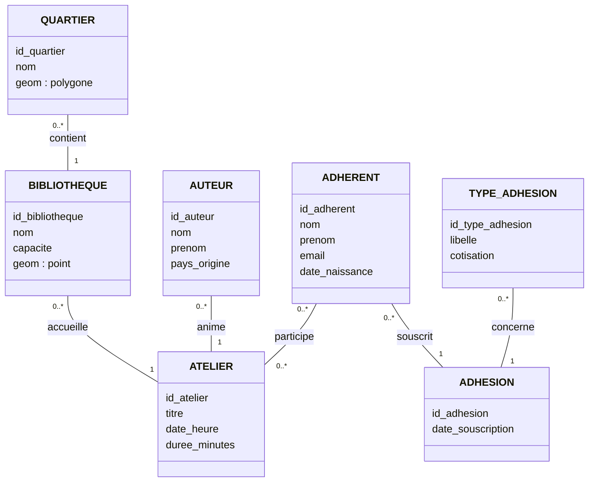

# Modélisation de données (ModelDon)
## Examen de rattrapage

**Date :** lundi 24 août 2026\
**Durée :** 2h00, sur papier\
**Documents autorisés :** une feuille A4 recto-verso manuscrite

> L'examen se déroule sur papier : aucune exécution de requête SQL ne sera possible. Il s'agit d'évaluer votre compréhension théorique, votre capacité à analyser des situations, et à produire des requêtes SQL correctes dans un contexte donné.
>
> Répondez dans les cadres prévus. Si l'espace est insuffisant, poursuivez sur une feuille de brouillon en indiquant votre nom, votre prénom et votre classe sur chaque feuille jointe à la copie.

---

## Barème

| Exercice | Points |
|---|:---:|
| Exercice 1 : MCD → MLD | 30 |
| Exercice 2 : Questions théoriques | 20 |
| Exercice 3 : Requêtes SQL | 50 |
| **TOTAL** | **100** |

---

## Contexte

**BiblioVaud** est un réseau de bibliothèques municipales géré par une agglomération du canton de Vaud. Pour améliorer sa gestion, le réseau souhaite mettre en place une base de données PostgreSQL avec l'extension PostGIS pour gérer les données spatiales.

Le réseau gère des quartiers (délimités par des polygones), des bibliothèques (avec leur position géographique), des auteurs, des ateliers littéraires, des adhérents et leurs adhésions.

**Quartiers et bibliothèques :**

- Le réseau est organisé en plusieurs quartiers (centre-ville, campus, quartier historique, etc.)
- Chaque quartier peut contenir plusieurs bibliothèques, mais une bibliothèque appartient toujours à un seul quartier

**Auteurs et ateliers :**

- Un auteur peut animer plusieurs ateliers pendant l'année, mais il est aussi possible qu'un auteur inscrit n'anime finalement aucun atelier
- Chaque atelier est assuré par un seul auteur
- Une bibliothèque peut accueillir plusieurs ateliers au cours de l'année, et chaque atelier se déroule dans une seule bibliothèque

**Adhérents, adhésions et participations :**

- Un adhérent peut souscrire plusieurs adhésions (par exemple pour renouveler chaque année)
- Chaque adhésion est associée à un seul adhérent, et à un seul type d'adhésion (Standard, Premium, Jeunesse, Senior...)
- Un adhérent peut participer à plusieurs ateliers, et un atelier accueille plusieurs adhérents ; on enregistre la date d'inscription de chaque participation

---

## Schéma conceptuel des données (MCD)

*L'association `participe` porte un attribut : la date d'inscription. Ce schéma est un MCD (Modèle Conceptuel de Données) : il ne comporte ni clé primaire (PK) ni clé étrangère (FK) explicite, c'est à vous de les faire apparaître dans le MLD de l'exercice 1.*

---

## Exercice 1 | MCD → MLD (30 pts)

À partir du schéma conceptuel ci-dessus, écrivez le Modèle Logique de Données (MLD). Pour chaque table, indiquez :

- Le nom de la table
- Les colonnes
- Les contraintes (PK, FK, NOT NULL, UNIQUE)
- Les tables nécessaires pour respecter les règles de normalisation (notamment pour l'association plusieurs-à-plusieurs)

> Répondez sur une feuille de brouillon, en indiquant votre nom, votre prénom et votre classe sur chaque feuille jointe à la copie.

---

## Exercice 2 | Questions théoriques (20 pts)

### Question 2.1 (5 pts)

Le réseau souhaite désormais gérer plusieurs saisons culturelles annuelles (Saison 2024-2025, Saison 2025-2026, etc.). Chaque saison a ses propres dates, son propre thème, et ses propres ateliers. Un auteur peut participer à plusieurs saisons.

Comment modifieriez-vous le modèle pour répondre à ce besoin ?

---

### Question 2.2 (5 pts)

Observez cette table non normalisée :

| atelier_id | auteur_nom | bibliotheques |
|---|---|---|
| 1 | Amélie Nothomb | Bibliothèque Centrale, Bibliothèque du Flon |
| 2 | Joël Dicker | Bibliothèque Centrale |

Identifiez quelle forme normale n'est pas respectée et proposez une correction.

---

### Question 2.3 (5 pts)

La cotisation d'un type d'adhésion est révisée chaque année. Aujourd'hui, la table des types d'adhésion ne contient que le tarif courant : dès qu'il change, on perd le tarif appliqué aux adhésions déjà souscrites.

Comment modifieriez-vous le modèle pour retrouver le tarif en vigueur à la date de souscription de chaque adhésion, tout en évitant la redondance ?

---

### Question 2.4 (5 pts)

Le réseau souhaite distinguer deux types de bibliothèques : les **Bibliothèques publiques** (accessibles à tous les adhérents) et les **Bibliothèques patrimoniales** (accessibles uniquement au personnel et aux chercheurs autorisés, avec un code d'accès et un responsable attitré).

Comment modéliseriez-vous cette spécialisation en MLD ? Justifiez votre choix.

---

## Exercice 3 | Requêtes SQL (50 pts)

Écrivez les requêtes SQL correspondant aux besoins exprimés ci-dessous. Appuyez-vous sur le MLD de l'exercice 1 pour les noms de tables et de colonnes.

### Question 1 (4 pts)

> « J'aimerais voir la liste de toutes les bibliothèques avec leur nom et leur capacité. »

---

### Question 2 (4 pts)

> « J'aimerais connaître les auteurs qui viennent de France ou de Belgique. »

---

### Question 3 (4 pts)

> « J'aimerais afficher les 5 adhésions les plus récemment souscrites. »

---

### Question 4 (5 pts)

> « J'aimerais savoir combien d'adhérents sont inscrits à chaque atelier. »

---

### Question 5 (5 pts)

> « J'aimerais connaître les quartiers dont la capacité moyenne des bibliothèques dépasse 100 places. »

---

### Question 6 (5 pts)

> « J'aimerais voir la liste des ateliers avec le nom de l'auteur et le nom de la bibliothèque, triée par date. »

---

### Question 7 (5 pts)

> « J'aimerais connaître les auteurs qui n'ont aucun atelier programmé. »

---

### Question 8 (6 pts)

> « J'aimerais savoir quel·les auteurs animent des ateliers dans des bibliothèques dont la capacité est supérieure à la capacité moyenne de toutes les bibliothèques. »

---

### Question 9 (6 pts)

> « J'aimerais connaître toutes les bibliothèques situées dans le quartier 'Centre-ville'. »

---

### Question 10 (6 pts)

> « J'aimerais créer une requête qui calcule le nombre total d'adhésions souscrites par type, puis afficher uniquement les types avec plus de 100 adhésions souscrites. »
>
> *Indice : utiliser une CTE.*

